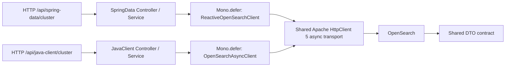

# Chapter 01 — Basic Connection


บทนี้เปรียบเทียบ **Spring Data OpenSearch reactive client** กับ **official OpenSearchAsyncClient** ต่อ OpenSearch จริงผ่าน Apache HttpClient 5 async transport ร่วมกัน มี services/controllers แยก path แต่ใช้ DTO และ behavioral assertions เดียวกัน

สถานะ: **Verified สองแนวทาง** ตาม [ผล verification ปัจจุบัน](VERIFICATION.md) ผล official-only ก่อน migration เก็บใน [historical report](verification/official-only-2026-10-25.md)

## Learning objectives และ scope

- เปรียบเทียบ Spring Data reactive API กับ official CompletableFuture API โดยไม่เปลี่ยนความหมายของ HTTP contract
- แยก async I/O ออกจากการนำ synchronous call ไป offload
- สร้าง future เมื่อ subscribe และสร้าง invocation ใหม่เมื่อ resubscribe
- อ่าน cluster metadata และแยก reachable/yellow health จาก connection failure
- ตั้ง transport timeouts, Reactor deadline และ Spring-managed lifecycle
- ตรวจทั้ง mocks, HTTP slice, Testcontainers และ packaged application

Prerequisites ด้านความรู้: Java records, constructor injection, HTTP/JSON และ Mono เบื้องต้น ไม่ต้องมีบทอื่น บทนี้ไม่มี document dataset, index creation, CRUD, authentication หรือ TLS; security อยู่ในบทถัดไป

## Versions และ prerequisites

| Component | Version |
|---|---|
| Application Java | 21 |
| Spring Boot / Spring Framework | 4.1.2 / 7.0.10 |
| OpenSearch server | 3.9.0 |
| Spring Data OpenSearch | 3.1.4 |
| Spring Data Elasticsearch abstraction | 6.1.2 (Boot-managed) |
| Official Java Client | 3.10.0 |
| Maven / Wrapper | 3.9.11 / 3.3.4 |
| Jackson 3 | 3.1.7 |
| Reactor Core | 3.8.8 |
| Apache HttpClient / HttpCore | 5.6.5 / 5.4.4 |
| JUnit Jupiter / Mockito / Testcontainers | 6.0.3 / 5.23.0 / 2.0.5 |

Spring Data library ยังนำ opensearch-rest-client 3.8.0 เข้ามาเป็น transitive dependency แต่ไม่มี RestClient bean หรือ RestClientTransport ถูกสร้างในบทนี้ Exclude opensearch-rest-high-level-client และไม่ได้ใช้ Spring Data starter เพื่อให้ wiring ชัดเจน ไม่พบ Elasticsearch Java Client ใน resolved graph

Client ยังนำ Jackson 2 runtime dependencies เข้ามาด้วย แต่ application และ OpenSearch transport เลือก Jackson 3 mapper อย่างชัดเจน ไม่ได้อ้างว่า classpath มี Jackson เพียง major เดียว

ใช้ versions จาก Boot BOM ยกเว้น explicit client/server/Wrapper pins ผู้ใช้อนุมัติ JUnit 6 เพราะ SpringExtension ของ Framework 7 ต้องใช้ 6+ ดู [decision](../docs/decisions/0003-test-platform-selection.md) และ [compatibility](../docs/compatibility.md) Version table ไม่ใช่ผลทดสอบ ดู actual status ที่ [VERIFICATION.md](VERIFICATION.md)

ต้องมี Docker Engine, Compose (v2+ CLI syntax), JDK 21, Bash, cURL และ Python 3.9+ สำหรับ smoke assertions ต้องเข้าถึง Maven Central/Docker Hub ครั้งแรก Wrapper มี distribution SHA-256 ที่ตรวจเทียบ official SHA-512 แล้ว

## Approach comparison และ feature coverage

| Feature | Spring Data path | Official path | Evidence |
|---|---|---|---|
| Cluster info | ReactiveOpenSearchClient.info (reactive-client tier) | OpenSearchAsyncClient.info | Selected-client IT + DTO parity |
| Cluster health | ReactiveOpenSearchClusterClient.health | OpenSearchClusterAsyncClient.health | Single-node assertions + DTO parity |
| Lazy subscription / fresh retry | Mono.defer รอบ reactive method invocation | Mono.defer รอบ future creation | 7 service tests ต่อ approach |
| Errors / deadlines | Shared sanitized 503/504 contract | Shared sanitized 503/504 contract | HTTP slice ทั้งสอง prefixes + legacy aliases |
| Transport lifecycle | Inject transport เดียวกัน, ปิด wrapper destroy callback | Inject transport เดียวกัน | Shutdown behavior test และ IT transport identity |
| Real packaged API | /api/spring-data/cluster/* | /api/java-client/cluster/* | Healthy/failure smoke พร้อม parity |

บทนี้ใช้ Spring Data reactive client เพราะ cluster metadata ไม่มี repository-level operation ที่เหมาะสม **ยังไม่สอน ReactiveRepository/ReactiveOpenSearchTemplate, entity mapping หรือ converters** และไม่ได้ปลอม Spring Data path ด้วยการเรียก JavaClient service เหตุผลนี้เป็น reactive-client tier ตาม [contract](../docs/dual-approach.md) ไม่ใช่ native repository coverage

Library สร้างบน Spring Data Elasticsearch จึงมี upstream packages ใน dependency graph แต่ actual bean คือ org.opensearch.data.client.osc.ReactiveOpenSearchClient ที่ใช้ OpenSearch transport

## Concepts และ request flow



Official service ใช้ Mono.defer ครอบ client invocation และ catch checked IOException ที่เกิดก่อนคืน future Future failure ส่งเป็น Reactor error; timeout ครอบ overall operation ไม่มี block/join/get/manual subscribe และไม่ใช้ boundedElastic รอบ async I/O

Spring Data service ใช้ Mono.defer รอบ client.info()/cluster().health() เพราะใน 3.1.4 library เริ่ม performRequestAsync ก่อนคืน Mono การคืน Mono อย่างเดียวจึงไม่รับประกัน laziness

ReactiveOpenSearchClient รับ shared OpenSearchTransport โดยตรง ไม่ใช้ default ReactiveOpenSearchConfiguration ซึ่งตั้ง RestClient-based transport Bean ของ reactive wrapper ใช้ destroyMethod ว่าง ส่วน transport bean ใช้ destroyMethod=close เป็น owner เดียว ทั้งสอง paths จึงใช้ endpoint, pool, mapper และ deadlines ชุดเดียวกัน

ทุก subscription เริ่ม request ใหม่ Test retry ใช้ `.retry(1)` เพื่อพิสูจน์คุณสมบัตินี้ แต่ application บทนี้ไม่ retry และปิด automatic transport retries Cancel ส่งต่อถึง future ได้ แต่ไม่รับประกัน network abort หรือ server-side cancellation Async ยังมี serialization/CPU work บน threads

Transport มี connection pool จำกัด 16 connections และ pool acquisition timeout ไม่มี application bulkhead/throughput guarantee บทนี้ไม่ streaming search results

## โครงสร้างโปรเจกต์

```text
01-basic-connection/
├── .mvn/
│   └── wrapper/
│       └── maven-wrapper.properties
├── requests/
│   └── examples.http
├── scripts/
│   └── smoke-test.sh
├── src/
│   ├── main/
│   │   ├── java/
│   │   │   └── com/
│   │   │       └── example/
│   │   │           └── learning/
│   │   │               └── opensearch/
│   │   │                   └── basicconnection/
│   │   │                       ├── config/
│   │   │                       │   ├── OpenSearchConfiguration.java
│   │   │                       │   └── OpenSearchProperties.java
│   │   │                       ├── controller/
│   │   │                       │   ├── JavaClientClusterConnectionController.java
│   │   │                       │   └── SpringDataClusterConnectionController.java
│   │   │                       ├── dto/
│   │   │                       │   ├── ClusterHealthResponse.java
│   │   │                       │   └── ClusterInfoResponse.java
│   │   │                       ├── exception/
│   │   │                       │   └── ApiExceptionHandler.java
│   │   │                       ├── service/
│   │   │                       │   ├── JavaClientClusterConnectionService.java
│   │   │                       │   └── SpringDataClusterConnectionService.java
│   │   │                       └── BasicConnectionApplication.java
│   │   └── resources/
│   │       └── application.yml
│   └── test/
│       └── java/
│           └── com/
│               └── example/
│                   └── learning/
│                       └── opensearch/
│                           └── basicconnection/
│                               ├── config/
│                               │   ├── OpenSearchConfigurationTest.java
│                               │   └── OpenSearchPropertiesTest.java
│                               ├── controller/
│                               │   └── ClusterConnectionControllerTest.java
│                               ├── integration/
│                               │   └── OpenSearchConnectionIT.java
│                               └── service/
│                                   ├── JavaClientClusterConnectionServiceTest.java
│                                   └── SpringDataClusterConnectionServiceTest.java
├── verification/
│   └── official-only-2026-10-25.md
├── .env.example
├── README.md
├── VERIFICATION.md
├── docker-compose.yml
├── mvnw
├── mvnw.cmd
└── pom.xml
```

- `OpenSearchConfiguration`: singleton transport, Jackson 3 mapper, pool/timeouts และ destroy method close
- `OpenSearchProperties`: ตรวจ endpoint และ timeout constraints ตั้งแต่ startup
- `JavaClientClusterConnectionService`: lazy CompletableFuture bridge และ metadata mapping
- `SpringDataClusterConnectionService`: deferred Spring Data reactive invocation และ metadata mapping
- `JavaClientClusterConnectionController`: official prefix และ backward-compatible aliases
- `SpringDataClusterConnectionController`: Spring Data prefix โดยไม่ delegate ไป direct service
- DTO records: contract คงที่ ไม่ส่ง vendor response ทั้งก้อน
- `ApiExceptionHandler`: sanitized ProblemDetail 503/504
- `OpenSearchConnectionIT`: isolated real OpenSearch, actual-client spies, response parity และ shared transport assertions
- `OpenSearchConfigurationTest`: shared transport ใช้งานไม่ได้หลัง Spring shutdown ไม่ได้ mock network failure

## Configuration

| Variable | Default | ใช้ที่ใด |
|---|---|---|
| OPENSEARCH_PORT | 9200 | Compose host port |
| OPENSEARCH_URI | http://127.0.0.1:9200 | Application endpoint |
| APP_HOST / APP_PORT | 127.0.0.1 / 8080 | Application bind |
| OPENSEARCH_CONNECT_TIMEOUT | 1s | TCP connection |
| OPENSEARCH_POOL_TIMEOUT | 1s | รอ connection จาก pool |
| OPENSEARCH_RESPONSE_TIMEOUT | 3s | Transport response |
| OPENSEARCH_REQUEST_TIMEOUT | 5s | Reactor deadline |

Timeouts ต้องอยู่ระหว่าง 1ms–60s Endpoint ของบทนี้รองรับ HTTP พร้อม host และ optional port เท่านั้น ไม่มี userinfo/path/query/fragment การใช้ URI ผิดทำให้ startup fail ไม่ได้เปิด proxy API ที่ผู้ใช้ส่ง endpoint มาเอง

Compose อ่าน .env แต่ host JVM ไม่โหลด .env อัตโนมัติ หากเปลี่ยน host port ให้ export OPENSEARCH_URI คู่กัน Security ปิดเฉพาะ local learning และ bind localhost ห้ามเปิดออก network หรือใช้ configuration นี้เป็น production baseline Server ใช้ JVM ที่มากับ image แยกจาก JDK ของ application

## Quick Start

จาก repository root:

```bash
cd 01-basic-connection
java -version
./mvnw -version
docker version
docker compose version
```

ให้ทั้ง Java และ Wrapper เลือก JDK 21 ถ้าจำเป็นให้ตั้ง JAVA_HOME ตามเครื่อง ตัวอย่าง macOS:

```bash
export JAVA_HOME="$(/usr/libexec/java_home -v 21)"
./mvnw -version
```

Default configuration ไม่ต้องมี .env หาก ports ชน ตัวอย่างตั้งค่าใน shell เดียวกันก่อนเริ่ม:

```bash
export OPENSEARCH_PORT=19200
export OPENSEARCH_URI=http://127.0.0.1:19200
export APP_PORT=18080
```

เริ่ม OpenSearch และตรวจ API readiness:

```bash
docker compose -p os-learning-ch01 up -d --wait --wait-timeout 180
docker compose -p os-learning-ch01 ps
curl --fail-with-body "http://127.0.0.1:${OPENSEARCH_PORT:-9200}/_cluster/health?wait_for_status=yellow&timeout=3s"
```

รัน tests ทั้งหมด (Testcontainers เปิด cluster ของตัวเองที่ random port ไม่ใช้ Compose):

```bash
./mvnw clean verify
```

จาก terminal แรก รัน packaged application:

```bash
java -jar target/basic-connection.jar
```

จากอีก terminal ใน directory ของบท หลัง application เริ่มพร้อมแล้ว:

```bash
BASE_URL="http://127.0.0.1:${APP_PORT:-8080}" bash scripts/smoke-test.sh healthy
```

ถ้าตั้ง ports ใน terminal แรก ต้องตั้ง APP_PORT ใน terminal ที่สองด้วยหรือกำหนด BASE_URL ตรง ๆ Script ไม่ start/stop infrastructure และจบ nonzero หาก HTTP/fields ไม่ตรง

## API examples และ expected assertions

```bash
# Official async client
curl --fail-with-body "http://127.0.0.1:${APP_PORT:-8080}/api/java-client/cluster/info"
curl --fail-with-body "http://127.0.0.1:${APP_PORT:-8080}/api/java-client/cluster/health"
# Spring Data reactive client
curl --fail-with-body "http://127.0.0.1:${APP_PORT:-8080}/api/spring-data/cluster/info"
curl --fail-with-body "http://127.0.0.1:${APP_PORT:-8080}/api/spring-data/cluster/health"
# Legacy aliases ของ official client
curl --fail-with-body "http://127.0.0.1:${APP_PORT:-8080}/api/cluster/info"
curl --fail-with-body "http://127.0.0.1:${APP_PORT:-8080}/api/cluster/health"
```

| Endpoint | HTTP | Expected fields |
|---|---|---|
| GET /api/java-client/cluster/info หรือ /api/spring-data/cluster/info | 200 | clusterName=learning-ch01, nodeName=learning-ch01-node, distribution=opensearch, version=3.9.0 และ clusterUuid ที่ไม่ว่าง |
| GET /api/java-client/cluster/health หรือ /api/spring-data/cluster/health | 200 | clusterName=learning-ch01, numberOfNodes=1, numberOfDataNodes=1, timedOut=false และ status green/yellow |
| ทุก prefix เมื่อ dependency unreachable | 503 | title=OpenSearch unavailable พร้อม sanitized detail |
| Transport socket timeout หรือ Reactor deadline | 504 | title=OpenSearch timeout |

Legacy policy: เก็บ `/api/cluster/info` และ `/api/cluster/health` เป็น aliases ของ official controller โดยไม่ redirect และไม่มี logic ซ้ำ Tests ตรวจทั้งสอง alias และ smoke เรียกจริงรวมทั้งหมด 6 routes

clusterUuid และ health status เป็น dynamic Health เป็นข้อมูลจริง: 200 แปลว่าตอบ health API ได้ ไม่ได้รับประกัน green หรือ production readiness Yellow อาจเกิดจาก replica ที่ไม่สามารถ assign บน single node

ทดสอบ failure กับ application ที่ยังรันอยู่:

```bash
docker compose -p os-learning-ch01 stop opensearch
BASE_URL="http://127.0.0.1:${APP_PORT:-8080}" bash scripts/smoke-test.sh unavailable
```

Script ตรวจทั้ง 6 routes ว่าเป็น 503 และ assert error parity โดยไม่นำ route-specific instance มาเทียบเท่ากัน และไม่มีรายละเอียด connection ภายใน Upstream authentication error ก็ไม่กลายเป็น caller 401 Timeout 504 มี deterministic unit/HTTP tests; ไม่แกล้งทำว่า connection refused คือ timeout

## Testing และ verification

Surefire มี 41 cases: properties 8, transport lifecycle 1, official service 7, Spring Data service 7 และ HTTP slice 18 ตรวจ no call ก่อน subscribe, mapping, fresh resubscription/retry, synchronous/asynchronous errors, cancellation และ virtual-time deadline แยกแต่ละ approach HTTP slice ใช้ SpringExtension/JUnit 6 จริง ตรวจ route delegation และ shared sanitized 503/504/security contracts

Failsafe มี 8 IT cases: info/health แยก 3 prefixes รวม 6 cases, response parity 1 และ transport/dependency wiring 1 ใช้ GenericContainer ที่ pin image และ dynamic endpoint บน random application port ตรวจ cluster/node/version/UUID กับ health จริง

@MockitoSpyBean ใช้ spy client ที่เรียก real methods ไม่ stub responses ตรวจว่า Spring Data route เรียก ReactiveOpenSearchClient จริงและไม่ได้เรียก official wrapper ใน request นั้น (และกลับกัน) ทั้งสองยัง share lower-level transport ตามที่ตั้งใจ ไม่มี mocked search server บทนี้ไม่มี document fixtures เพราะยังไม่สร้าง indices/data

Surefire รัน *Test; Failsafe รัน *IT และ fail เมื่อไม่พบ tests Docker ไม่พร้อมถือว่า verify ไม่ผ่าน ไม่มี skipTests/skipITs ใน full verification

```bash
# ตรวจ dependencies เมื่อเปลี่ยน baseline
./mvnw dependency:tree
./mvnw help:effective-pom
```

Actual counts, environment, image digest, failures/retests และข้อจำกัดอยู่ใน [VERIFICATION.md](VERIFICATION.md) Hosted CI/platform อื่นต้องตรวจเพิ่มตามจริง

## Cleanup

กด Ctrl+C ใน terminal ที่รัน application เพื่อให้ Spring ปิด transport แล้วหยุด Compose resources ของบท:

```bash
docker compose -p os-learning-ch01 down
```

คำสั่งนี้เก็บ named data volume ไว้ ไม่ใช้ volumes removal โดยปริยาย และไม่ปิด Docker Desktop หรือ containers ของงานอื่น Testcontainers จัดการ temporary containers ของตัวเอง

## Pitfalls และ production considerations

- `java` กับ `mvn` อาจเลือกคนละ JDK ให้ตรวจ Wrapper ด้วย
- Startup ของ app ไม่พิสูจน์ OpenSearch พร้อม ต้องเรียก API
- Pool limit ไม่ใช่ request rate limit; deadlines ไม่รับประกัน operation ถูกยกเลิก
- Serializer exceptions ไม่ควรถูกซ่อนเป็น connection failure ทุกชนิด
- Single-node/no-auth ไม่พิสูจน์ TLS, permission, HA หรือ performance
- ตรวจ Docker memory/kernel requirements ของ exact image หาก bootstrap fail
- Mockito อาจเตือนเรื่อง dynamic agent บน Java 21; report ต้องแยก warning จาก test failures

## Exercises

1. Core: เปลี่ยน OPENSEARCH_PORT/URI คู่กันแล้วรัน healthy assertions อีกครั้ง
2. Core: หยุด OpenSearch โดยไม่หยุด app สังเกต 503 และ sanitized error จากนั้น start Compose ใหม่
3. Core: อ่าน laziness/retry tests อธิบายว่าทำไมเก็บ future เดิมไว้นอก defer แล้ว retry จึงไม่เริ่ม I/O ใหม่
4. Optional: ปรับ request deadline ในช่วงที่อนุญาต แล้วตรวจ virtual-time timeout test เพื่อแยก deadline จาก TCP failure ไม่ใช้ผลนี้อ้าง production latency

## Sources

- [Spring Data OpenSearch v3.1.4](https://github.com/opensearch-project/spring-data-opensearch/releases/tag/v3.1.4)
- [Spring Data reactive client source](https://github.com/opensearch-project/spring-data-opensearch/blob/v3.1.4/spring-data-opensearch/src/main/java/org/opensearch/data/client/osc/ReactiveOpenSearchClient.java)
- [OpenSearch Java Client](https://docs.opensearch.org/latest/clients/java/)
- [Client compatibility](https://github.com/opensearch-project/opensearch-java/blob/main/COMPATIBILITY.md)
- [Reactor Mono](https://projectreactor.io/docs/core/release/api/reactor/core/publisher/Mono.html)
- [SpringExtension 7.0.10](https://docs.spring.io/spring-framework/docs/7.0.10/javadoc-api/org/springframework/test/context/junit/jupiter/SpringExtension.html)
- [Docker installation](https://docs.opensearch.org/latest/install-and-configure/install-opensearch/docker/)
