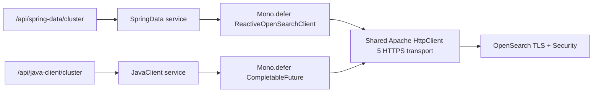

# Chapter 02 — Security and TLS

บทนี้เรียน HTTPS, certificate trust, hostname verification, authentication และ least privilege ผ่าน **Spring Data OpenSearch reactive client** และ **official OpenSearchAsyncClient** ทั้งสอง paths ใช้ async transport เดียวกัน แต่เรียกคนละ client จริง ไม่มี dependency ไป Chapter 01

สถานะ: **Verified สองแนวทาง** ตามผลและขอบเขตใน [VERIFICATION.md](VERIFICATION.md) ห้ามถือ version table หรือ illustrative response เป็น runtime evidence

## Learning objectives และ scope

- เชื่อมต่อ OpenSearch ที่เปิด Security plugin และ TLS โดยเชื่อถือ CA เฉพาะของบท
- แยก trust chain ออกจาก hostname/SAN verification และพิสูจน์ negative cases
- ใช้ application identity ที่อ่าน metadata ได้ แต่ไม่มี index/admin privileges
- เปรียบเทียบ native upstream 401/403 กับ normalized application errors
- รักษา reactive laziness, deadlines, cancellation limits และ single transport ownership

Prerequisites: Java records, Mono, HTTP และ X.509 เบื้องต้น ไม่ต้องรันบทอื่น ไม่มี document dataset/mappings/CRUD ในบทนี้ และไม่สอน OAuth/OIDC, SigV4, production CA/rotation หรือ multi-node cluster Application-facing HTTP bind loopback สำหรับเรียน ส่วน HTTPS เป็นเส้นทาง application → OpenSearch เท่านั้น ไม่ใช่ production deployment template

## Versions และ prerequisites

| Component | Pin / baseline |
|---|---|
| Application Java | 21 |
| Spring Boot / Framework | 4.1.2 / 7.0.10 |
| OpenSearch image | opensearchproject/opensearch:3.9.0 |
| Spring Data OpenSearch | 3.1.4 |
| Official Java Client | 3.10.0 |
| Maven / Wrapper | 3.9.11 / 3.3.4 |
| Jackson 3 / HttpClient 5 | Boot/client graph; ดู resolved evidence ใน VERIFICATION |
| Test platform | Boot-managed JUnit 6, Mockito, Testcontainers 2.0.5 |

ผู้ใช้อนุมัติ baseline/JUnit 6 ของบทนี้พร้อมแผน ไม่มี override JUnit engine/API ลงเป็น 5 ใช้ Spring Data core พร้อม explicit beans และ exclude high-level REST client เหมือน Chapter 01 ไม่ใช้ Spring Data starter/default RestClient transport

ต้องมี JDK 21, Bash, Docker Engine/Compose, OpenSSL, cURL และ jq; Maven Wrapper ดาวน์โหลด dependencies ครั้งแรก Tests ต้องใช้ Docker และ OpenSSL จริง ไม่ skip integration tests เมื่อ Docker ไม่พร้อม Secure ITs ตรวจบน local Docker โดย certificate SAN ครอบคลุม localhost, 127.0.0.1 และ opensearch; remote Docker host ต้องปรับ test certificates ตาม hostname จริงก่อน ไม่ปิด verification

## Concepts และ identities

TLS ตรวจสองเรื่องแยกกัน: certificate chain ต้องเชื่อมถึง CA ที่เรา trust และ DNS/IP ใน URI ต้องตรง SAN ของ server certificate แม้ CA ถูกต้อง hostname ผิดก็ต้อง fail Authentication ยืนยัน identity ส่วน authorization ตัดสิน underlying OpenSearch action

| Identity | Allowed cluster actions | Expected |
|---|---|---|
| ch02_monitor | cluster:monitor/main, cluster:monitor/health | Info/health ผ่าน ไม่มี index permissions |
| ch02_info_only | cluster:monitor/main | Info ผ่าน health ถูกปฏิเสธ |
| security-admin certificate | Bootstrap Security configuration | ไม่ mount ให้ application หรือ node service |

ไม่ใช้ built-in admin password, demo users, wildcard cluster role หรือ anonymous authentication `securityadmin.sh` ใช้ admin certificate ที่ DN ตรง config และไม่ใช้ `-nhnv` CA/admin private keys แยกจาก HTTP/node private keys Node และ REST layer เปิด TLS ทั้งคู่ REST client certificate เป็น OPTIONAL เพื่อรองรับ bootstrap admin; application ใช้ Basic authentication ผ่าน HTTPS

## โครงสร้างโปรเจกต์

```text
02-security-and-tls/
├── .env.example
├── .gitignore
├── .mvn/
│   └── wrapper/
│       └── maven-wrapper.properties
├── README.md
├── VERIFICATION.md
├── config/
│   ├── opensearch.yml
│   └── security/
│       ├── action_groups.yml
│       ├── allowlist.yml
│       ├── config.yml
│       ├── internal_users.yml.template
│       ├── nodes_dn.yml
│       ├── roles.yml
│       ├── roles_mapping.yml
│       └── tenants.yml
├── docker-compose.yml
├── mvnw
├── mvnw.cmd
├── pom.xml
├── requests/
│   └── examples.http
├── scripts/
│   ├── initialize-security.sh
│   ├── prepare-security.sh
│   └── smoke-test.sh
└── src/
    ├── main/
    │   ├── java/
    │   │   └── com/
    │   │       └── example/
    │   │           └── learning/
    │   │               └── opensearch/
    │   │                   └── securitytls/
    │   │                       ├── SecurityTlsApplication.java
    │   │                       ├── config/
    │   │                       │   ├── OpenSearchConfiguration.java
    │   │                       │   ├── OpenSearchProperties.java
    │   │                       │   └── OpenSearchTlsContextFactory.java
    │   │                       ├── controller/
    │   │                       │   ├── JavaClientClusterConnectionController.java
    │   │                       │   └── SpringDataClusterConnectionController.java
    │   │                       ├── dto/
    │   │                       │   ├── ClusterHealthResponse.java
    │   │                       │   └── ClusterInfoResponse.java
    │   │                       ├── exception/
    │   │                       │   └── ApiExceptionHandler.java
    │   │                       └── service/
    │   │                           ├── JavaClientClusterConnectionService.java
    │   │                           └── SpringDataClusterConnectionService.java
    │   └── resources/
    │       └── application.yml
    └── test/
        └── java/
            └── com/
                └── example/
                    └── learning/
                        └── opensearch/
                            └── securitytls/
                                ├── config/
                                │   ├── OpenSearchConfigurationTest.java
                                │   ├── OpenSearchPropertiesTest.java
                                │   └── OpenSearchTlsContextFactoryTest.java
                                ├── controller/
                                │   └── ClusterConnectionControllerTest.java
                                ├── exception/
                                │   └── ApiExceptionHandlerTest.java
                                ├── integration/
                                │   ├── OpenSearchTlsFailureIT.java
                                │   └── SecureOpenSearchConnectionIT.java
                                ├── service/
                                │   ├── JavaClientClusterConnectionServiceTest.java
                                │   └── SpringDataClusterConnectionServiceTest.java
                                └── support/
                                    └── SecureOpenSearchTestEnvironment.java
```

`OpenSearchConfiguration` อ่าน CA/password files ตอน startup สร้าง bounded async connection pool และ endpoint-scoped credentials ปิด redirects และ automatic retries `OpenSearchTlsContextFactory` สร้าง SSLContext เฉพาะ transport ไม่แก้ global JVM defaults Hostname verification เปิดทั้ง JSSE และ client verifier

Services แยก SpringData/JavaClient คืน shared DTO semantics Controllers บางและมีเพียงสี่ GET routes `ApiExceptionHandler` ตรวจ typed upstream status และ cause chain ที่มีขอบเขต ไม่ parse error message หรือเปิดเผย private details



## Coverage และ limitations

| Feature | Spring Data path | Official path | Proof |
|---|---|---|---|
| Metadata/health | ReactiveOpenSearchClient / reactive cluster client | OpenSearchAsyncClient / async cluster client | Real server HTTP/parity |
| TLS/authentication | Shared HTTPS transport | Shared HTTPS transport | Positive, wrong CA, wrong password |
| Authorization | Info-only user health denied | Same identity/permissions | Native 403 และ normalized 502 |
| Hostname validation | Shared strict verifier | Shared strict verifier | Valid trusted cert with wrong SAN |
| Lazy lifecycle | Mono.defer | Deferred future creation | Unit tests และ real-client spies |

Spring Data อยู่ใน reactive-client tier ไม่ใช่ repository/template coverage ไม่มี fake Spring Data fallback ที่เรียก official service ภายใน การแชร์ transport เป็น intentional เพื่อเปรียบเทียบ client wrappers ภายใต้ security policy เดียวกัน ไม่พิสูจน์ว่า Spring Data default transport มีพฤติกรรมเหมือนกัน

## Configuration และ generated material

| Setting | Default |
|---|---|
| APP_HOST / APP_PORT | 127.0.0.1 / 8082 |
| OPENSEARCH_URI | https://localhost:9202 |
| OPENSEARCH_CA_CERTIFICATE | certs/generated/public/ca.pem |
| OPENSEARCH_USERNAME | ch02_monitor |
| OPENSEARCH_PASSWORD_FILE | certs/generated/secrets/monitor.password |
| OPENSEARCH_PORT (Compose) | 9202 |
| Connect / pool / response / overall timeout | 1s / 1s / 3s / 5s |

Compose `.env` ไม่ export ให้ host JVM เมื่อเปลี่ยน Compose port ต้องตั้ง OPENSEARCH_URI ให้ตรงด้วย URI ไม่รับ user-info/path/query/fragment และต้องเป็น HTTPS CA/password file ที่ไม่มีหรืออ่านไม่ได้ทำให้ startup fail; wrong CA ที่ parse ได้ทำให้ request handshake fail

Generated material ทั้งหมดอยู่ใน ignored `certs/generated/` ไม่มี secrets ใน Git Script สร้าง CA อายุ 30 วัน และ leaf certificates 7 วัน ไม่มี production persistence/rotation CA key เก็บใน `ca-private/`; node อ่าน node/http keys และ CA public certificate เท่านั้น Bootstrap container อ่าน admin key และ security hashes ชั่วคราว Host application อ่าน CA และ selected password เท่านั้น

Parent generated directory จำกัด 0700 ส่วน files ที่ mount ไป non-root OpenSearch ต้องอ่านได้ใน container จึงมี permission 0644 ภายใต้ parent ที่จำกัด owner บน host Private material นี้เหมาะกับ local isolated learning; Docker access/host owner ยังอ่านได้ เช่นเดียวกับ Docker env ที่ใช้ระหว่าง hashing ห้ามใช้กับ shared untrusted host ไม่แสดง password/hash ใน logs หรือ command-line arguments

อย่า regenerate CA/users ทับ data volume เดิม `prepare-security.sh` ปฏิเสธ existing output หากต้อง reset ให้เลือก project data ที่เป็นของบทนี้อย่างชัดเจนและลบเฉพาะเมื่อยอมรับการสูญเสียข้อมูลแล้ว ค่า passwords อยู่ใน files ไม่ฝังใน records หรือ URI และไม่ส่งผ่าน incoming API requests

## Quick Start

```bash
cd 02-security-and-tls
cp .env.example .env
bash scripts/prepare-security.sh
# ตรวจ config โดยไม่ dump expanded values ลง logs
docker compose config --quiet
docker compose up -d opensearch
bash scripts/initialize-security.sh
docker compose ps
./mvnw -B -ntp clean verify
java -jar target/security-and-tls.jar
```

`initialize-security.sh` ตรวจ TLS endpoint ก่อน bootstrap ไม่รอ authenticated health จนเกิด circular readiness จากนั้น one-shot service ใช้ admin certificate initialize security index และตรวจ readiness ด้วย monitor user การรันซ้ำเขียนทับ security users/roles จาก YAML จึงใช้เฉพาะ disposable cluster ของบทนี้ ไม่ใช้กับ existing external cluster

## API examples และ expected results

จากอีก terminal ที่เข้า directory ของบท:

```bash
curl -fsS http://127.0.0.1:8082/api/spring-data/cluster/info | jq .
curl -fsS http://127.0.0.1:8082/api/spring-data/cluster/health | jq .
curl -fsS http://127.0.0.1:8082/api/java-client/cluster/info | jq .
curl -fsS http://127.0.0.1:8082/api/java-client/cluster/health | jq .
bash scripts/smoke-test.sh healthy
```

Expected: HTTP 200, clusterName `learning-ch02`, distribution `opensearch`, version `3.9.0`, health มีหนึ่ง node/data node และ timedOut=false Health green/yellow ยอมรับได้ UUID เป็น dynamic value ต้องไม่ว่างและไม่ใช่ `_na_` Script assert fields และ parity แทนดูเพียง status

Native OpenSearch examples ใช้ generated cURL config files เพื่อไม่ใส่ password ใน argv:

```bash
curl -sS --cacert certs/generated/public/ca.pem --config certs/generated/secrets/monitor.curl \
  -w '\nHTTP %{http_code}\n' https://localhost:9202/
curl -sS --cacert certs/generated/public/ca.pem --config certs/generated/secrets/invalid.curl \
  -w '\nHTTP %{http_code}\n' https://localhost:9202/
curl -sS --cacert certs/generated/public/ca.pem --config certs/generated/secrets/info.curl \
  -w '\nHTTP %{http_code}\n' https://localhost:9202/_cluster/health
curl -sS --cacert certs/generated/public/ca.pem --config certs/generated/secrets/monitor.curl \
  -X PUT -w '\nHTTP %{http_code}\n' https://localhost:9202/ch02-forbidden-index
```

Expected ตามลำดับ: 200, 401, 403, 403 ไม่มีการสร้าง index สำเร็จ Application ใช้ backend-owned credentials จึง normalize upstream authentication/authorization เป็น 502 ไม่ส่ง WWW-Authenticate ให้ caller login แก้ backend credentials

| Failure | Application HTTP | ProblemDetail code |
|---|---|---|
| Untrusted certificate / SAN mismatch | 502 | OPENSEARCH_TLS_FAILURE |
| Invalid application credentials | 502 | OPENSEARCH_AUTHENTICATION_FAILED |
| Missing application permissions | 502 | OPENSEARCH_AUTHORIZATION_FAILED |
| Dependency unavailable | 503 | OPENSEARCH_UNAVAILABLE |
| Deadline / socket timeout | 504 | OPENSEARCH_TIMEOUT |

ProblemDetail มี fixed title/detail และ request instance ไม่ส่ง raw exception, secrets, CA paths หรือ DN TLS failure เกิดก่อน HTTP จึงไม่มี native upstream HTTP status

## Failure exercises

หยุดเฉพาะ application process เดิมก่อนแต่ละ scenario แล้วเริ่ม process ใหม่ด้วย configuration ด้านล่าง จากอีก terminal รัน smoke mode ที่ตรงกัน:

```bash
# Info ผ่าน health ถูกปฏิเสธ
OPENSEARCH_USERNAME=ch02_info_only OPENSEARCH_PASSWORD_FILE=certs/generated/secrets/info.password \
  java -jar target/security-and-tls.jar
# อีก terminal: bash scripts/smoke-test.sh insufficient-permissions

# Wrong password
OPENSEARCH_PASSWORD_FILE=certs/generated/secrets/invalid.password java -jar target/security-and-tls.jar
# อีก terminal: bash scripts/smoke-test.sh invalid-credentials

# CA ถูก parse ได้ แต่ไม่ใช่ CA ของ server
OPENSEARCH_CA_CERTIFICATE=certs/generated/public/unrelated-ca.pem java -jar target/security-and-tls.jar
# อีก terminal: bash scripts/smoke-test.sh tls-failure
```

Hostname mismatch พิสูจน์ด้วย OpenSearchTlsFailureIT ที่ใช้ real server certificate จาก trusted CA เดิม แต่ SAN เป็น `wrong.invalid` ไม่เปลี่ยน local DNS หรือใช้ TLS bypass ให้ restore correct CA/user แล้ว restart application ก่อนทดลอง dependency failure:

```bash
docker compose stop opensearch
bash scripts/smoke-test.sh unavailable
docker compose start opensearch
# รอ authenticated readiness แล้วลอง healthy อีกครั้ง
```

Transport deadline พิสูจน์แบบ deterministic ด้วย StepVerifier virtual time ไม่ใช้ network sleep เดาเพื่อให้เกิด timeout Cancellation ถึง future ไม่รับประกัน server-side abort หรือ rollback

## Testing และ verification

```bash
./mvnw -B -ntp test
./mvnw -B -ntp clean verify
```

Surefire ค้นหา `*Test`; Failsafe ค้นหา `*IT` และรัน real secure OpenSearch บน random ports โดยเตรียม CA/users เองใน `target/` ไม่พึ่ง Compose instance หรือ generated material ของผู้เรียน Test orchestration ใช้ blocking calls บน test thread เท่านั้น ไม่อยู่ใน production Reactor pipeline

Cases ครอบคลุม lazy/resubscription/retry/error/cancel/deadline, property/CA/password validation, typed error mapping, HTTP contracts, native 401/403, denied index creation, trust failure และ valid-trusted-but-wrong-SAN failure พร้อม transport lifecycle และ selected-client spies จำนวน tests และผล actual อยู่ใน VERIFICATION.md ไม่ใช่คำรับรองว่าทุก platform ผ่าน

## Cleanup และ troubleshooting

หยุด application ด้วย Ctrl-C แล้ว:

```bash
docker compose down
```

คำสั่งนี้เก็บ data volume และ generated material ไว้ ไม่สั่ง down -v โดยปริยาย Tests ปิด containers/networks และลบ temporary keys ที่สร้างเองผ่าน lifecycle หากถูก kill ให้ตรวจเฉพาะ resources ที่เกี่ยวข้องก่อน cleanup ไม่ prune Docker ทั้งเครื่อง

- PKIX/SSL error: ตรวจ CA, SAN, อายุ certificate และ URI โดยไม่ปิด verification
- 401: ตรวจ selected username/password file; 403: ตรวจ underlying action/role mapping
- Startup fail: ตรวจ Java 21, CA/password paths และ file permissions
- Compose healthy รอค้าง: เปิด logs และ initialize-security ก่อน เพราะ healthcheck ต้องใช้ authenticated user
- Volume เดิม/keys ใหม่: ห้าม reinitialize โดยไม่ทราบผลกระทบต่อ security index
- Unit/IT ไม่เริ่ม: ตรวจ Docker socket/context, OpenSSL และ Surefire/Failsafe reports ไม่ skip tests เพื่อประกาศผ่าน

## Sources

- [OpenSearch TLS](https://docs.opensearch.org/latest/security/configuration/tls/)
- [Security administration](https://docs.opensearch.org/latest/security/configuration/security-admin/)
- [Permissions](https://docs.opensearch.org/latest/security/access-control/permissions/)
- [Client 3.10.0 transport source](https://github.com/opensearch-project/opensearch-java/blob/v3.10.0/java-client/src/main/java/org/opensearch/client/transport/httpclient5/ApacheHttpClient5TransportBuilder.java)
- [Spring Data OpenSearch 3.1.4](https://github.com/opensearch-project/spring-data-opensearch/tree/v3.1.4)

Links แบบ latest ต้องเทียบ pinned image/source เสมอ; runtime scope ของบทนี้อ้าง VERIFICATION.md
