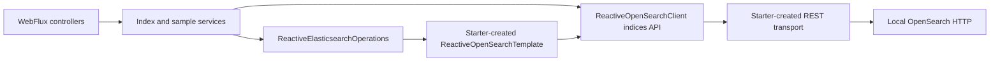

# Chapter 04: Index mappings and settings

บทนี้เรียน **explicit mapping**, Spring Data mapping annotations/converter และ index settings ผ่าน `spring-data-opensearch-starter` แนวทางเดียว ตาม scope ที่อนุมัติ ใช้ HTTP สำหรับ local learning โดยปิด security ไม่ใช้ authentication, API Key, TLS หรือ certificate จากบทอื่น ทุกอย่างรันได้จาก directory นี้

## สารบัญ

- [เป้าหมายและขอบเขต](#objectives)
- [ภาพรวม concepts](#concepts)
- [Prerequisites และ versions](#prerequisites)
- [เลือกเส้นทางเริ่มเรียน](#learning-path)
- [Step 1–4: เตรียมและเปิดระบบ](#setup)
- [Step 5–8: สร้าง index และทดลองข้อมูล/settings](#index-experiments)
- [Step 9: ทดลองข้อจำกัด](#validation-experiments)
- [Step 10: เปรียบเทียบ text กับ keyword](#search-experiments)
- [Step 11–12: Smoke และ cleanup](#smoke-cleanup)
- [Troubleshooting](#troubleshooting)
- [API contract และ errors](#api-reference)
- [Architecture และ configuration](#architecture)
- [อ่าน source ต่อ](#source-guide)
- [Testing และหลักฐาน](#testing)
- [Sources](#sources)

<a id="objectives"></a>

## เป้าหมายและขอบเขต

- สร้าง index อย่างชัดเจนจาก Spring Data metadata แล้วอ่าน mapping/settings ที่ OpenSearch เก็บจริง
- เข้าใจ `text` กับ `keyword`, multi-field, integer/long, boolean และ UTC date
- พิสูจน์ `dynamic: strict` และ `index.mapping.coerce: false` ด้วย invalid documents ที่ส่งตรงเข้า OpenSearch
- แยก dynamic settings (`number_of_replicas`, `refresh_interval`) จาก final setting (`number_of_shards`) และ field type ที่เปลี่ยนแทนของเดิมไม่ได้
- เขียน/อ่าน product sample เพื่อพิสูจน์ converter เท่านั้น Full CRUD, update/conflicts และ pagination อยู่บทถัดไป

<a id="concepts"></a>

## เข้าใจภาพรวมก่อนเริ่ม

| แนวคิด | ใช้ตอบคำถามอะไร | ตัวอย่างในบท |
|---|---|---|
| Mapping | แต่ละ field เก็บข้อมูลชนิดใด | `stock` เป็น `integer`, `createdAt` เป็น `date` |
| Settings | index ทำงานอย่างไร | shards `1`, replicas `0`, refresh interval `1s` |
| Converter | Java object ถูกแปลงไปและกลับจาก document อย่างไร | `ProductDocument` และ `Instant` |

`text` ใช้กับข้อความที่ผ่าน analyzer เพื่อค้นหา ส่วน `keyword` ใช้กับค่าเต็มสำหรับ exact match บทนี้เก็บ `name` เป็น `text` และมี multi-field `name.raw` เป็น `keyword` จากชื่อสินค้าเดียวกัน แล้วทดลองความต่างใน Step 10

กฎรับ document สองข้อทำหน้าที่ต่างกัน: `dynamic: strict` ปฏิเสธ field ที่ไม่ได้ประกาศ ส่วน `coerce=false` ปิดการแปลงชนิดให้อัตโนมัติ เช่น string `"10"` ไปเป็น integer กฎเหล่านี้ไม่ได้บังคับว่าทุก field ต้องมีค่า การตรวจ required fields ของ HTTP request อยู่ที่ DTO validation

เส้นทางทดลองคือ **สร้าง index → อ่าน mapping/settings → บันทึก sample → เปลี่ยน settings → ทดลองข้อจำกัด → เปรียบเทียบการค้นหา**

<a id="prerequisites"></a>

## Prerequisites และ versions

JDK 21, Docker Engine/Compose ที่พร้อมใช้งาน, Bash, cURL และ jq สำหรับ smoke ต้องมี ports `8084` และ `9204` ว่าง ใช้ Maven Wrapper ของบท ไม่มี Maven installation หรือ build ของบทอื่นเป็น prerequisite Linux/Docker VM ต้องตรงตาม [OpenSearch Docker prerequisites](https://docs.opensearch.org/latest/install-and-configure/install-opensearch/docker/) เช่น memory และ kernel limits ไม่ปรับ host settings ให้อัตโนมัติ

| Component | Pin / policy |
|---|---|
| Spring Boot / Java | 4.1.2 / 21 |
| Spring Data OpenSearch starter | 3.1.4 |
| OpenSearch Java Client / server image | 3.10.0 / opensearchproject/opensearch:3.9.0 |
| Maven / Wrapper | 3.9.11 / 3.3.4 |
| JUnit / Mockito / Testcontainers | Boot-managed; resolved versions และ tested platform ใน [VERIFICATION](VERIFICATION.md) |

<a id="learning-path"></a>

## เรียนแบบ Step by step

| เริ่มแบบไหน | ลำดับที่ทำ |
|---|---|
| เรียนครั้งแรก | ทำ Step 1–12 ตามลำดับ |
| กลับมาเรียนต่อและมี JAR แล้ว | ทำ Step 2 และ 4 เพื่อเปิดระบบ แล้วตรวจ index ใน Step 5 หากพบ index เดิม ให้ข้ามการทดลองก่อนสร้างและ POST ใน Step 6 แต่ยัง GET mapping/settings ได้ จากนั้นทำ Step 7 ต่อ |
| แก้ source/configuration หรือยังไม่มี JAR | รัน Step 3 เพื่อ tests/build ก่อนเปิด app |
| ต้องการรัน smoke อย่างเดียว | เปิดระบบตาม Step 1–4 แล้วไป Step 11 โดย index ต้องยังไม่มีอยู่ |

ทำ Step 1–4 ใน **Terminal A** แล้วใช้ **Terminal B** สำหรับ Step 5–12 เพราะ application รันค้างอยู่ใน Terminal A ทุก terminal ต้องอยู่ใน directory ของบท ตัวอย่างใช้ app port `8084`, OpenSearch port `9204` และ index `ch04-products`

แต่ละขั้นมีคำสั่งและผลที่ควรเห็น ผลด้านล่างเป็น expected behavior สำหรับใช้ตรวจระหว่างเรียน หลักฐานการรันจริงอยู่ใน [VERIFICATION.md](VERIFICATION.md)

<a id="setup"></a>

### Step 1 — เข้า directory และเตรียม configuration (Terminal A)

เริ่มจาก root repository:

```bash
cd 04-index-mappings-and-settings
# สร้าง .env เฉพาะเมื่อยังไม่มีไฟล์ เพื่อเก็บค่าที่เคยตั้งไว้
if [ ! -f .env ]; then cp .env.example .env; fi
docker compose config --quiet
```

**ผลที่ควรเห็น:** `docker compose config --quiet` จบโดยไม่มี error `.env` มีเพียง non-secret port ของ Compose ไม่มีขั้นตอนสร้าง credentials/certificates คำสั่งต่อจากนี้ต้องรันจาก directory ของบท เพื่อให้ Wrapper, Compose และ fixtures อ้างไฟล์ถูกต้อง

### Step 2 — เปิด OpenSearch และตรวจ readiness (Terminal A)

```bash
docker compose up -d --wait opensearch
docker compose ps
curl -fsS 'http://localhost:9204/_cluster/health?wait_for_status=yellow&timeout=3s' | jq '{status, timed_out, number_of_nodes}'
```

**ผลที่ควรเห็น:** service เป็น healthy, `timed_out` เป็น `false` และ `number_of_nodes` เป็น `1` ส่วน `status` เป็น `green` หรือ `yellow` ได้ `--wait` รอ health check แบบมีขอบเขต หากคำสั่งไม่ผ่าน ให้แก้ Docker/readiness ก่อนทำขั้นต่อไป

Compose bind `127.0.0.1` และปิด security สำหรับเครื่องเรียนเท่านั้น ห้าม expose configuration นี้สู่อินเทอร์เน็ต มี persistent volume แต่ไม่ seed หรือสร้าง product index ตอน startup `action.auto_create_index=+.*,-*` ยอม system indices ที่ขึ้นต้นจุดและปฏิเสธ automatic creation ของ business indices การสร้างผ่าน explicit index API ยังทำได้

### Step 3 — รัน tests และ build JAR (Terminal A)

```bash
./mvnw -B -ntp clean verify -Dmaven.compiler.showDeprecation=true
```

**ผลที่ควรเห็น:** `BUILD SUCCESS` และไฟล์ `target/index-mappings-and-settings.jar` Maven รัน unit/HTTP tests และเปิด **Testcontainers อีก instance แยกจาก Compose** สำหรับ ITs จึงต้องให้ Docker พร้อมใช้งาน แม้เปิด Compose แล้วก็ตาม Compiler warnings ของ deprecated REST transport เป็นข้อจำกัดของ starter รุ่นนี้ ดูรายละเอียดในส่วน Architecture และ configuration ท้ายบท

### Step 4 — เปิด application (Terminal A)

```bash
java -jar target/index-mappings-and-settings.jar
```

**ผลที่ควรเห็น:** application เริ่มสำเร็จและฟังที่ `127.0.0.1:8084` ปล่อย terminal นี้รันค้างไว้ แล้วใช้ Terminal B เรียก API

หากเปลี่ยน `OPENSEARCH_PORT` ใน `.env` เป็น `19204` ให้ใช้คำสั่งด้านล่างแทน และเปลี่ยน URL ของ OpenSearch ในตัวอย่างต่อไปให้ตรงกัน Spring Boot ไม่โหลด Compose `.env` เข้า **host JVM** อัตโนมัติ:

```bash
OPENSEARCH_URI=http://localhost:19204 java -jar target/index-mappings-and-settings.jar
```

<a id="index-experiments"></a>

### Step 5 — ตรวจสถานะก่อนสร้าง index (Terminal B)

เปิด terminal อีกอันจาก root repository:

```bash
cd 04-index-mappings-and-settings
curl -sS -w '\nHTTP %{http_code}\n' http://localhost:8084/api/spring-data/indices/products/mapping
```

**ผลที่ควรเห็นเมื่อยังไม่มี index:** HTTP `404` และ `code` เป็น `INDEX_NOT_FOUND` หากได้ `200` ให้ใช้เส้นทาง “กลับมาเรียนต่อ” ในตารางด้านบน

ตัวอย่าง error เฉพาะ fields สำคัญจาก app (ไม่ใช่ response เต็มหรือ log การรัน):

```json
{
  "title": "Chapter 04 operation failed",
  "status": 404,
  "detail": "The chapter operation could not be completed.",
  "code": "INDEX_NOT_FOUND"
}
```

ลองบันทึก sample ก่อนสร้าง index เฉพาะกรณีที่ยังไม่มี index:

```bash
curl -sS -w '\nHTTP %{http_code}\n' -X PUT http://localhost:8084/api/spring-data/mapping-examples/products/p-001 \
  -H 'Content-Type: application/json' --data-binary @fixtures/product.json
```

**ผลที่ควรเห็น:** HTTP `409` และ `code` เป็น `INDEX_NOT_READY` การบันทึก document ไม่สร้าง business index ให้อัตโนมัติ

### Step 6 — สร้าง index แล้วอ่าน mapping/settings (Terminal B)

```bash
curl -sS -w '\nHTTP %{http_code}\n' -X POST http://localhost:8084/api/spring-data/indices/products
```

**ผลที่ควรเห็น:** HTTP `201`, `indexName` เป็น `ch04-products` และ `acknowledged` เป็น `true`

อ่านค่าที่ OpenSearch เก็บจริง:

```bash
curl -fsS http://localhost:8084/api/spring-data/indices/products/mapping | jq
curl -fsS http://localhost:8084/api/spring-data/indices/products/settings | jq
```

**ผลที่ควรเห็น:** HTTP `200` ทั้งสองคำสั่ง mapping มี `dynamic: strict`, `stock` เป็น `integer` และ `name.raw` เป็น `keyword` ส่วน settings มี shards `1`, replicas `0`, refresh interval `1s` และ coerce `false` ใช้ตาราง Mapping ด้านล่างเทียบทีละ field ได้

ตัวอย่าง JSON เฉพาะส่วนของ mapping สำหรับเทียบกับผลจริง (ละ fields อื่นไว้):

```json
{
  "indexName": "ch04-products",
  "mapping": {
    "dynamic": "strict",
    "properties": {
      "name": {
        "type": "text",
        "fields": {
          "raw": { "type": "keyword", "ignore_above": 256 }
        }
      },
      "stock": { "type": "integer" }
    }
  }
}
```

**สิ่งที่ได้เรียนรู้:** annotations เป็น metadata ที่ Spring Data ใช้สร้าง mapping ส่วน GET นี้อ่านค่าจาก server จึงใช้ตรวจได้ว่า index ถูกสร้างตามที่ตั้งใจ

#### อ่าน Mapping ที่ได้จาก Step 6

| Field | Mapping / หน้าที่ |
|---|---|
| `id` | `_id` metadata ไม่เก็บซ้ำใน `_source` |
| `name` | `text` สำหรับ analyzed search + `name.raw` เป็น `keyword`, ignore_above=256 |
| `category` | `keyword` สำหรับ exact value |
| `priceSatang` | `long` จำนวนเงินหน่วยสตางค์ |
| `stock` | `integer` |
| `available` | `boolean` |
| `createdAt` | `date`, ตัวอย่าง UTC `2026-01-01T00:00:00Z` |
| `_class` | Spring Data type hint เป็น `keyword` ให้ converter ทำงานร่วมกับ strict mapping |

`@Document(createIndex=false, dynamic=STRICT, storeIdInSource=false)` ไม่สร้าง index ตอน startup `ReactiveIndexOperations.createMapping(ProductDocument.class)` สร้าง metadata mapping แล้ว `create(settings, mapping)` สร้าง index พร้อมกัน Fixture `fixtures/product.json` เป็นข้อมูลสังเคราะห์ที่เขียนสำหรับบทนี้ ไม่ใช้ข้อมูลส่วนบุคคลหรือ external dataset ใช้ ID/UTC timestamp คงที่เพื่อ assertions ที่ทำซ้ำได้

Settings file อยู่ `src/main/resources/opensearch/product-index-settings.json` กำหนด shards=1, replicas=0, refresh=1s และ coerce=false อย่างชัดเจน

### Step 7 — บันทึกและอ่าน product sample (Terminal B)

```bash
curl -fsS -X PUT http://localhost:8084/api/spring-data/mapping-examples/products/p-001 \
  -H 'Content-Type: application/json' --data-binary @fixtures/product.json | jq
curl -fsS http://localhost:8084/api/spring-data/mapping-examples/products/p-001 | jq
```

**ผลที่ควรเห็น:** HTTP `200` ทั้งสองคำสั่ง ข้อมูล product มีชื่อ `Mechanical Keyboard`, `stock` เป็น `10` และ `priceSatang` เป็น `129900` (1,299.00 บาท) เก็บเงินเป็น integer เพื่อไม่ใช้ floating point การ GET by ID อ่านได้ทันทีโดยไม่ต้องรอ search refresh

**สิ่งที่ได้เรียนรู้:** HTTP DTO, Java domain object และ OpenSearch document เชื่อมกันผ่าน converter โดย `_id` เป็น metadata แยกจาก `_source`

การรัน PUT ซ้ำด้วย ID `p-001` จะเขียนทับ sample ของ ID เดิม

### Step 8 — เปลี่ยน dynamic settings แล้วคืนค่า (Terminal B)

```bash
curl -fsS -X PATCH http://localhost:8084/api/spring-data/indices/products/settings \
  -H 'Content-Type: application/json' -d '{"numberOfReplicas":1,"refreshInterval":"2s"}' | jq
curl -fsS http://localhost:8084/api/spring-data/indices/products/settings | jq
```

**ผลที่ควรเห็น:** HTTP `200` และค่าที่อ่านกลับเป็น replicas `1`, refresh interval `2s` Single node ไม่มี node อื่นรับ replica จึงอาจมี health เป็น `yellow`

คืนค่าเริ่มต้นก่อนทำขั้นต่อไป:

```bash
curl -fsS -X PATCH http://localhost:8084/api/spring-data/indices/products/settings \
  -H 'Content-Type: application/json' -d '{"numberOfReplicas":0,"refreshInterval":"1s"}' | jq
```

**ผลที่ควรเห็น:** replicas กลับเป็น `0` และ refresh interval เป็น `1s` API บังคับ PATCH ให้ส่งทั้งสอง fields: replicas `0..1` และ refresh interval `1s`, `2s`, `5s` เท่านั้น เป็นขอบเขตของบท ไม่ใช่ข้อจำกัดทั้งหมดของ OpenSearch DTO ปฏิเสธ unknown JSON fields ด้วย `400` เช่นส่ง `numberOfShards` ใน PATCH

**สิ่งที่ได้เรียนรู้:** replicas และ refresh interval เป็น dynamic settings เปรียบเทียบกับ final setting ใน Step 9.4

<a id="validation-experiments"></a>

### Step 9 — ทดลองข้อมูลผิดและการเปลี่ยนค่าที่ห้ามเปลี่ยน (Terminal B)

รันเมื่อ index ถูกสร้างแล้ว ตัวอย่างเหล่านี้ส่งตรงไป OpenSearch เพื่อแยก server behavior จาก `@Valid` ของ HTTP DTO ผล error ของ native API มีโครงสร้างต่างจาก ProblemDetail ของ app ให้ดู HTTP status และ `error` ของ OpenSearch

#### 9.1 — เมื่อส่ง string แทน integer จะเกิดอะไรขึ้น?

```bash
# 400 mapper_parsing_exception: numeric string ก็ไม่ยอม coerce
curl -sS -w '\nHTTP %{http_code}\n' -X PUT http://localhost:9204/ch04-products/_doc/bad \
  -H 'Content-Type: application/json' -d '{"stock":"10"}'
curl -sS -w '\nHTTP %{http_code}\n' -X PUT http://localhost:9204/ch04-products/_doc/bad \
  -H 'Content-Type: application/json' -d '{"stock":"abc"}'
```

**ผลที่ควรเห็น:** HTTP `400` ทั้งสองคำสั่ง เพราะ `coerce=false` ไม่รับ string แทน integer ทั้ง numeric string และข้อความ

**สิ่งที่ได้เรียนรู้:** `coerce=false` ทำให้ numeric string ถูกปฏิเสธด้วย แม้ข้อความนั้นจะดูเหมือนตัวเลข

#### 9.2 — เมื่อส่ง field ที่ไม่ได้ประกาศจะเกิดอะไรขึ้น?

```bash
# 400 strict_dynamic_mapping_exception: unknown field
curl -sS -w '\nHTTP %{http_code}\n' -X PUT http://localhost:9204/ch04-products/_doc/bad \
  -H 'Content-Type: application/json' -d '{"unknownField":"unexpected"}'
```

**ผลที่ควรเห็น:** HTTP `400` จาก strict mapping ไม่ยอมรับ `unknownField`

**สิ่งที่ได้เรียนรู้:** `dynamic: strict` ควบคุมชื่อ field ที่ยอมรับ แยกจากการตรวจชนิดของค่าภายใน field

#### 9.3 — เปลี่ยนชนิดของ field เดิมได้หรือไม่?

```bash
# 400 illegal_argument_exception: เปลี่ยน stock จาก integer เป็น keyword ไม่ได้
curl -sS -w '\nHTTP %{http_code}\n' -X PUT http://localhost:9204/ch04-products/_mapping \
  -H 'Content-Type: application/json' -d '{"properties":{"stock":{"type":"keyword"}}}'
```

**ผลที่ควรเห็น:** HTTP `400`, error type เป็น `illegal_argument_exception`

**สิ่งที่ได้เรียนรู้:** การเปลี่ยนชนิด field เดิมต้องออกแบบ index ใหม่และย้ายข้อมูล ซึ่งจะเรียน reindex ภายหลัง

#### 9.4 — เปลี่ยนจำนวน primary shards แบบเดียวกับ replicas ได้หรือไม่?

```bash
# 400: number_of_shards เป็น final setting เปลี่ยนแทนของเดิมไม่ได้ แม้ close index
curl -sS -w '\nHTTP %{http_code}\n' -X PUT http://localhost:9204/ch04-products/_settings \
  -H 'Content-Type: application/json' -d '{"index.number_of_shards":2}'
```

**ผลที่ควรเห็น:** HTTP `400`, error type เป็น `illegal_argument_exception`

**สิ่งที่ได้เรียนรู้:** primary shards กับ replicas มีข้อจำกัดการเปลี่ยนต่างกัน ตรวจว่า setting ใดเปลี่ยนบน index เดิมได้ก่อนนำไปใช้

<a id="search-experiments"></a>

### Step 10 — Refresh แล้วเปรียบเทียบ text กับ keyword (Terminal B)

**เป้าหมาย:** ใช้ sample จาก Step 7 สังเกตความต่างระหว่างการค้นหาคำใน `name` กับค่าเต็มใน `name.raw` การทดลองนี้ส่งตรงไป OpenSearch เพื่ออ่านผลของ mapping ไม่เพิ่ม search endpoint ใน application

GET by ID ใน Step 7 อ่านได้ทันที แต่ search ต้องรอ document มองเห็นผ่าน refresh ก่อน สั่ง refresh อย่างชัดเจนเพื่อไม่ต้องใช้ sleep:

```bash
curl -fsS -X POST http://localhost:9204/ch04-products/_refresh | jq
```

#### 10.1 — ค้นหาคำบางส่วนด้วย match บน text

```bash
curl -fsS -X POST http://localhost:9204/ch04-products/_search \
  -H 'Content-Type: application/json' -d '{"query":{"match":{"name":"keyboard"}}}' | jq '.hits.hits | map(._id)'
```

**ผลที่ควรเห็น:** array มี `"p-001"` เพราะ analyzer ของ field `name` แยก `Mechanical Keyboard` เป็นคำ และ match query วิเคราะห์คำค้นด้วย จึงค้นด้วย `keyboard` ได้

#### 10.2 — ค้นหาค่าเต็มด้วย term บน keyword

```bash
curl -fsS -X POST http://localhost:9204/ch04-products/_search \
  -H 'Content-Type: application/json' -d '{"query":{"term":{"name.raw":"Mechanical Keyboard"}}}' | jq '.hits.hits | map(._id)'
```

**ผลที่ควรเห็น:** array มี `"p-001"` เพราะตรงกับค่าเต็มใน `name.raw`

ลองใช้เพียงคำเดียวกับ field เดิม:

```bash
curl -fsS -X POST http://localhost:9204/ch04-products/_search \
  -H 'Content-Type: application/json' -d '{"query":{"term":{"name.raw":"keyboard"}}}' | jq '.hits.hits | map(._id)'
```

**ผลที่ควรเห็นเมื่อมีเพียง sample ของบท:** `[]` เพราะ `keyboard` ไม่ตรงกับค่าเต็ม `Mechanical Keyboard` หากใช้ index ที่มีข้อมูลอื่นอยู่แล้ว อาจพบ documents อื่นที่มีค่าเต็มตรงกับคำค้น

**สิ่งที่ได้เรียนรู้:** multi-field ทำให้ชื่อเดียวกันรองรับทั้ง analyzed search และ exact match โดยไม่ต้องส่ง `name.raw` เพิ่มใน JSON ของ product การเลือก query ต้องสอดคล้องกับ mapping

**ลองต่อด้วยตัวเอง:** เปลี่ยนค่าใน term query เป็น `mechanical keyboard` แล้วสังเกตว่า default keyword field นี้แยกตัวพิมพ์ใหญ่เล็กอย่างไร อีกแบบฝึกหัดคือเพิ่ม field ใหม่ผ่าน native `PUT _mapping` แล้วอ่าน mapping กลับมาตรวจ โดยการเพิ่ม field ต่างจากการเปลี่ยน type ของ field เดิม

<a id="smoke-cleanup"></a>

### Step 11 — รัน smoke test (เลือกทำใน Terminal B)

Smoke ต้องเริ่มตอนที่ **ยังไม่มี index ของบท** หากทำ Step 6–10 แล้วและต้องการเก็บข้อมูลไว้ ให้ข้ามขั้นนี้ Script จะปฏิเสธเมื่อพบ index เดิมเพื่อไม่ลบงานผู้เรียน

หากต้องการลบข้อมูลตัวอย่างใน `ch04-products` เพื่อทดสอบ smoke ให้รันขณะ app ยังเปิดอยู่:

```bash
curl -sS -w '\nHTTP %{http_code}\n' -X DELETE http://localhost:8084/api/spring-data/indices/products
```

**ผลที่ควรเห็น:** HTTP `204` จากนั้นรัน:

```bash
bash scripts/smoke-test.sh
```

**ผลที่ควรเห็น:** script จบด้วย exit code `0` เมื่อ assertions ผ่าน Smoke ตรวจทุก API และ native mapping failures พร้อม status/fields และลบเฉพาะ index ที่ตัวเองสร้าง ไม่หยุด app/container

Smoke เปลี่ยน default URLs ได้ผ่าน `APP_URL`, `OPENSEARCH_URI`, `LEARNING_INDEX_NAME` ให้ตรงกับ app ส่วน app port เปลี่ยนได้ด้วย `APP_PORT` หรือ `--server.port` ตาม Spring Boot

### Step 12 — หยุด application และ OpenSearch

หากข้าม smoke และต้องการลบ index ของบท ให้ใช้คำสั่ง DELETE ใน Step 11 ก่อนหยุด app หากต้องการเก็บข้อมูลไว้เรียนต่อ ให้คง index ไว้

1. กด **Ctrl+C ใน Terminal A** เพื่อหยุด application
2. รันคำสั่งนี้ใน **Terminal B** ที่ directory ของบท:

```bash
docker compose down
```

**ผลที่ควรเห็น:** Compose หยุดและนำ container ของบทออก คำสั่งนี้ไม่ใส่ `-v` จึงเก็บ volume และข้อมูล index ที่ยังไม่ได้ลบไว้ เมื่อกลับมาเรียนให้ตรวจ index เดิมตาม Step 5 ก่อนสร้างใหม่

<a id="troubleshooting"></a>

## Troubleshooting

รันคำสั่งตรวจต่อไปนี้จาก directory ของบท หากใช้ custom ports ให้แทน URL ด้วยค่าที่ตั้งไว้

| อาการ | ตรวจอะไร | วิธีดำเนินการ |
|---|---|---|
| Compose แจ้ง port ถูกใช้งาน | `docker compose ps` และ `lsof -nP -iTCP:9204 -sTCP:LISTEN` บน macOS/Linux ที่มี lsof | เลือก port ว่างใน `.env` แล้วส่ง `OPENSEARCH_URI` ให้ app ตาม Step 4 |
| App เปิดไม่ได้เพราะ port 8084 ถูกใช้ | `lsof -nP -iTCP:8084 -sTCP:LISTEN` | ใช้ `APP_PORT=18084 java -jar target/index-mappings-and-settings.jar` แล้วเปลี่ยน app URLs และ `APP_URL` ของ smoke ให้ตรง |
| Docker หรือ Testcontainers เชื่อมต่อไม่ได้ | `docker info` | เปิด Docker Engine/Desktop และตรวจให้คำสั่งนี้ผ่านก่อนรัน Maven ใหม่ ไม่ skip IT เพื่อข้ามปัญหา |
| OpenSearch ไม่ healthy | `docker compose ps` และ `docker compose logs --tail=100 opensearch` | ตรวจ startup errors, memory และ kernel requirements ตาม Docker prerequisites ก่อนเริ่ม app |
| cURL ไป app แล้ว connection refused | ดู startup log ใน Terminal A | ตรวจว่า app ยังรันอยู่และใช้ port ถูกต้อง หากปิดไปให้เริ่มใหม่ตาม Step 4 |
| App ตอบ `503 OPENSEARCH_UNAVAILABLE` | เรียก health URL ใน Step 2 | ตรวจ Compose, host port และ `OPENSEARCH_URI` ของ host JVM; การเปลี่ยน `.env` อย่างเดียวไม่เปลี่ยน URI ของ app |
| POST ได้ `409 INDEX_ALREADY_EXISTS` | GET mapping/settings ตาม Step 6 | ใช้ index เดิมต่อและข้าม POST ไม่ต้องลบข้อมูลเพื่อเริ่ม app |
| Smoke ปฏิเสธเพราะมี index เดิม | GET mapping ตาม Step 5 | เก็บข้อมูลแล้วข้าม smoke หรือเลือก DELETE เฉพาะ index ของบทตาม Step 11 ก่อนรันใหม่ |
| GET by ID พบ แต่ search ยังไม่พบ | ตรวจว่า save สำเร็จและ query ใช้ field ถูกต้อง | ทำ explicit refresh ตาม Step 10 แล้วลอง query ใหม่ |

<a id="api-reference"></a>

## API contract และ errors

| Method / path (หลัง `/api/spring-data`) | Success | Representative failure |
|---|---|---|
| POST `/indices/products` | 201 indexName/acknowledged | 409 INDEX_ALREADY_EXISTS |
| GET `/indices/products/mapping` | 200 indexName/mapping | 404 INDEX_NOT_FOUND |
| GET `/indices/products/settings` | 200 shards/replicas/refresh/coerce | 404 INDEX_NOT_FOUND |
| PATCH `/indices/products/settings` | 200 settings ที่อ่านกลับ | 400 INVALID_REQUEST / 404 INDEX_NOT_FOUND |
| DELETE `/indices/products` | 204 | 404 INDEX_NOT_FOUND |
| PUT `/mapping-examples/products/{id}` | 200 product sample | 400 INVALID_REQUEST / 409 INDEX_NOT_READY |
| GET `/mapping-examples/products/{id}` | 200 product sample | 404 PRODUCT_NOT_FOUND / INDEX_NOT_FOUND |

ID รับ `[a-zA-Z0-9_-]{1,64}` ผิดรูปแบบได้ 400 INVALID_PRODUCT_ID Error ใช้ ProblemDetail มี `code` โดยไม่ส่ง raw transport details Index API ชี้ได้เฉพาะชื่อที่ configure ใน namespace `ch04-` ไม่มี endpoint รับ arbitrary index/wildcard หาก backend ไม่พร้อมได้ 503 OPENSEARCH_UNAVAILABLE; deadline ได้ 504 OPENSEARCH_TIMEOUT; backend ปฏิเสธ request ได้ 400 OPENSEARCH_REQUEST_REJECTED กรณีไม่ acknowledged ได้ 504 INDEX_NOT_ACKNOWLEDGED

<a id="architecture"></a>

## Architecture และ configuration

Starter ดึง Spring Data OpenSearch core และสร้าง client/transport/template/converter ให้ ไม่มี manual client/transport factory หรือ auto-configuration exclusions SDK เป็น explicit dependency เพราะ published starter/core POM รุ่นนี้ไม่ได้ให้ SDK เอง Exclude `elasticsearch-rest5-client` และ `opensearch-rest-high-level-client` เพื่อคงเฉพาะ client stack ที่บทใช้ ชื่อ `ReactiveElasticsearchOperations` เป็น abstraction ของ Spring Data แต่ implementation ที่ tests ตรวจคือ `ReactiveOpenSearchTemplate`

Exact release นี้ใช้ deprecated `RestClientTransport` และ `RestClientBuilder` เป็น native defaults คง auto-configuration ตาม scope ที่อนุมัติและเปิดเผย compiler warnings ไม่ suppress ไม่กล่าวว่าการใช้ starter ทำให้ internals ทั้งหมดไม่ deprecated การปิด Spring context ตรวจจริงใน IT โดยไม่เพิ่ม close callbacks ซ้อน



Index lifecycle/mapping/settings read และ product save/get ใช้ operations/template ส่วน dynamic settings write ใช้ native reactive-client tier `indices().putSettings` โดยระบุ boundary นี้อย่างชัดเจน ไม่มี official-client application path เพิ่ม ทุก I/O defer ก่อน subscription มี request deadline ไม่มี block/join/manual subscribe ใน request flow Classpath settings อ่านครั้งเดียวตอน startup

| Property | Default | หน้าที่ |
|---|---|---|
| `opensearch.uris` | http://localhost:9204 | HTTP endpoint เดียว ไม่มี credentials/path/query/fragment |
| `opensearch.connection-timeout` | 1s | Starter ใช้ทั้ง connect และ pool acquisition |
| `opensearch.socket-timeout` | 3s | Customizer apply เป็น Apache response timeout เพราะ starter 3.1.4 ยังไม่ apply เอง |
| `learning.request-timeout` | 5s | Reactor overall operation deadline 1..60s และต้อง >= socket-timeout |
| `learning.index-name` | ch04-products | namespace `ch04-` ใช้ IndexCoordinates ตลอดทุก operation |

Transport properties ไม่ทำซ้ำใน `learning` มีเพียง application-level deadline/index Connect/pool/response เป็นคนละช่วงกัน Response timeout ไม่ใช่ total operation deadline และ Reactor timeout/cancel ไม่รับประกันหยุด network I/O หรือ rollback write สำเร็จ ปิด automatic HTTP retries/redirects ใน customizer และไม่มี application retry writes อัตโนมัติ ผล write ที่ timeout อาจสำเร็จแล้วให้ตรวจสถานะก่อนลองใหม่

<a id="source-guide"></a>

## อ่าน source ต่อจากสิ่งที่ทดลอง

อ่านตามลำดับนี้เพื่อเชื่อม API ที่เรียกกับ implementation:

| ลำดับ | ไฟล์ | จุดที่ควรสังเกต |
|---|---|---|
| 1 | [ProductIndexController](src/main/java/com/example/learning/opensearch/mappings/controller/ProductIndexController.java) | routes ของ index lifecycle/mapping/settings ใน Step 5–6 และ 8 |
| 2 | [ProductIndexService](src/main/java/com/example/learning/opensearch/mappings/service/ProductIndexService.java) | createMapping → create(settings, mapping), อ่านค่าจาก server และ native reactive putSettings |
| 3 | [ProductSampleController](src/main/java/com/example/learning/opensearch/mappings/controller/ProductSampleController.java) | routes สำหรับ sample ใน Step 7 |
| 4 | [ProductSampleService](src/main/java/com/example/learning/opensearch/mappings/service/ProductSampleService.java) | save/get ผ่าน reactive operations, defer และ request deadline |
| 5 | [ProductDocument](src/main/java/com/example/learning/opensearch/mappings/domain/ProductDocument.java) | @Document, @Field, @MultiField, @Id และ Instant ที่กำหนด converter metadata |
| 6 | [product-index-settings.json](src/main/resources/opensearch/product-index-settings.json) | ค่าเริ่มต้น shards/replicas/refresh/coerce ที่ใช้สร้าง index |
| 7 | [OpenSearchConfiguration](src/main/java/com/example/learning/opensearch/mappings/config/OpenSearchConfiguration.java) | response-timeout customizer และการใช้ starter สร้าง infrastructure |
| 8 | [ApiExceptionHandler](src/main/java/com/example/learning/opensearch/mappings/exception/ApiExceptionHandler.java) | การแปลงข้อผิดพลาดเป็น ProblemDetail พร้อม code ของ app |
| 9 | [ProductServicesTest](src/test/java/com/example/learning/opensearch/mappings/service/ProductServicesTest.java) | unit assertions ของ lazy invocation, retry, cancellation และ deadline |
| 10 | [IndexMappingsIT](src/test/java/com/example/learning/opensearch/mappings/integration/IndexMappingsIT.java) | real-server assertions ของ mapping/converter/settings และ lifecycle |

ดู environment defaults ที่ [application.yml](src/main/resources/application.yml) และ HTTP validation/errors ที่ [ProductControllerTest](src/test/java/com/example/learning/opensearch/mappings/controller/ProductControllerTest.java) เพิ่มเติม

<a id="testing"></a>

## Testing และหลักฐาน

Unit tests ตรวจ lazy/retry/sync errors/cancellation/deadline, HTTP validation/errors และ starter wiring Real OpenSearch ITs ตรวจ generated mapping, converter, persisted data, numeric coercion/strict failures, dynamic/final settings, no auto-create และ native shutdown ใช้ unique `ch04-it-*`, random mapped ports และ cleanup เฉพาะ index/container ที่สร้าง ไม่ skip required IT เมื่อ Docker หาย

ผลที่รันจริงและข้อจำกัด platform อยู่ใน [VERIFICATION.md](VERIFICATION.md) CI รัน Maven unit/HTTP/IT ผ่าน explicit matrix แต่ packaged smoke เป็น gate แยก

<a id="sources"></a>

## Sources

- [Spring Data OpenSearch 3.1.4](https://github.com/opensearch-project/spring-data-opensearch/tree/v3.1.4)
- [OpenSearch index settings](https://docs.opensearch.org/latest/install-and-configure/configuring-opensearch/index-settings/)
- [Update mappings](https://docs.opensearch.org/latest/api-reference/index-apis/put-mapping/), [dynamic](https://docs.opensearch.org/latest/mappings/mapping-parameters/dynamic/) และ [coerce](https://docs.opensearch.org/latest/mappings/mapping-parameters/coerce/)

`latest` links อาจเปลี่ยน ผลจริงจำกัดตาม pinned versions ในบทนี้
