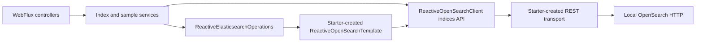

# Chapter 04: Index mappings and settings

บทนี้เรียน **explicit mapping**, Spring Data mapping annotations/converter และ index settings ผ่าน `spring-data-opensearch-starter` แนวทางเดียว ตาม scope ที่อนุมัติ ใช้ HTTP สำหรับ local learning โดยปิด security ไม่ใช้ authentication, API Key, TLS หรือ certificate จากบทอื่น ทุกอย่างรันได้จาก directory นี้

## เป้าหมายและขอบเขต

- สร้าง index อย่างชัดเจนจาก Spring Data metadata แล้วอ่าน mapping/settings ที่ OpenSearch เก็บจริง
- เข้าใจ `text` กับ `keyword`, multi-field, integer/long, boolean และ UTC date
- พิสูจน์ `dynamic: strict` และ `index.mapping.coerce: false` ด้วย invalid documents ที่ส่งตรงเข้า OpenSearch
- แยก dynamic settings (`number_of_replicas`, `refresh_interval`) จาก final setting (`number_of_shards`) และ field type ที่เปลี่ยนแทนของเดิมไม่ได้
- เขียน/อ่าน product sample เพื่อพิสูจน์ converter เท่านั้น Full CRUD, update/conflicts และ pagination อยู่บทถัดไป

## Prerequisites และ versions

JDK 21, Docker Engine/Compose ที่พร้อมใช้งาน, Bash, cURL และ jq สำหรับ smoke ต้องมี ports `8084` และ `9204` ว่าง ใช้ Maven Wrapper ของบท ไม่มี Maven installation หรือ build ของบทอื่นเป็น prerequisite Linux/Docker VM ต้องตรงตาม [OpenSearch Docker prerequisites](https://docs.opensearch.org/latest/install-and-configure/install-opensearch/docker/) เช่น memory และ kernel limits ไม่ปรับ host settings ให้อัตโนมัติ

| Component | Pin / policy |
|---|---|
| Spring Boot / Java | 4.1.2 / 21 |
| Spring Data OpenSearch starter | 3.1.4 |
| OpenSearch Java Client / server image | 3.10.0 / opensearchproject/opensearch:3.9.0 |
| Maven / Wrapper | 3.9.11 / 3.3.4 |
| JUnit / Mockito / Testcontainers | Boot-managed; resolved versions และ tested platform ใน [VERIFICATION](VERIFICATION.md) |

Starter ดึง Spring Data OpenSearch core และสร้าง client/transport/template/converter ให้ ไม่มี manual client/transport factory หรือ auto-configuration exclusions SDK เป็น explicit dependency เพราะ published starter/core POM รุ่นนี้ไม่ได้ให้ SDK เอง Exclude `elasticsearch-rest5-client` และ `opensearch-rest-high-level-client` เพื่อคงเฉพาะ client stack ที่บทใช้ ชื่อ `ReactiveElasticsearchOperations` เป็น abstraction ของ Spring Data แต่ implementation ที่ tests ตรวจคือ `ReactiveOpenSearchTemplate`

Exact release นี้ใช้ deprecated `RestClientTransport` และ `RestClientBuilder` เป็น native defaults คง auto-configuration ตาม scope ที่อนุมัติและเปิดเผย compiler warnings ไม่ suppress ไม่กล่าวว่าการใช้ starter ทำให้ internals ทั้งหมดไม่ deprecated การปิด Spring context ตรวจจริงใน IT โดยไม่เพิ่ม close callbacks ซ้อน

## เริ่มรัน: Terminal A

เปิด terminal ที่ root repository แล้วทำตามลำดับ:

```bash
cd 04-index-mappings-and-settings
cp .env.example .env
docker compose config --quiet
docker compose up -d --wait opensearch
docker compose ps
curl -fsS 'http://localhost:9204/_cluster/health?wait_for_status=yellow&timeout=3s' | jq '{status, timed_out, number_of_nodes}'
./mvnw -B -ntp clean verify -Dmaven.compiler.showDeprecation=true
java -jar target/index-mappings-and-settings.jar
```

`cd` เปลี่ยน working directory เพื่อให้ Wrapper, Compose และ fixtures อ้างไฟล์ของบทถูกต้อง `.env` มีเพียง non-secret port สำหรับ Compose ไม่มีขั้นตอนสร้าง credentials/certificates `--wait` รอ health check แบบมีขอบเขต Maven รัน unit/HTTP tests และเปิด **Testcontainers อีก instance แยกจาก Compose** เพื่อรัน ITs แล้ว package JAR คำสั่งสุดท้ายเปิด WebFlux app ที่ `127.0.0.1:8084` และค้าง foreground จนกด Ctrl+C

Compose bind `127.0.0.1` และปิด security สำหรับเครื่องเรียนเท่านั้น ห้าม expose configuration นี้สู่อินเทอร์เน็ต มี persistent volume แต่ไม่ seed หรือสร้าง product index ตอน startup `action.auto_create_index=+.*,-*` ยอม system indices ที่ขึ้นต้นจุดและปฏิเสธ automatic creation ของ business indices การสร้างผ่าน explicit index API ยังทำได้

หากเปลี่ยน port ใน `.env` เป็น `19204` ต้องส่ง URI ให้ **host JVM** เอง เพราะ Spring Boot ไม่โหลด Compose `.env`:

```bash
OPENSEARCH_URI=http://localhost:19204 java -jar target/index-mappings-and-settings.jar
```

## ทดลอง API: Terminal B

เปิด terminal อีกอันแล้ว `cd 04-index-mappings-and-settings` จาก root repository ทุก API ต่อไปนี้ใช้ default index `ch04-products` หากเคยทำแล้วให้ GET ตรวจของเดิมก่อน POST ไม่ลบข้อมูลเก่าโดยอัตโนมัติ

```bash
# ก่อนสร้าง index: 409 และ code INDEX_NOT_READY
curl -sS -w '\nHTTP %{http_code}\n' -X PUT http://localhost:8084/api/spring-data/mapping-examples/products/p-001 \
  -H 'Content-Type: application/json' --data-binary @fixtures/product.json

# สร้าง index: 201 {indexName: ch04-products, acknowledged: true}
curl -sS -w '\nHTTP %{http_code}\n' -X POST http://localhost:8084/api/spring-data/indices/products

# อ่าน mapping และ settings จริง: 200
curl -fsS http://localhost:8084/api/spring-data/indices/products/mapping | jq
curl -fsS http://localhost:8084/api/spring-data/indices/products/settings | jq

# Upsert sample และอ่านทันทีด้วย GET by ID: 200 ทั้งคู่ ไม่ต้องรอ search refresh
curl -fsS -X PUT http://localhost:8084/api/spring-data/mapping-examples/products/p-001 \
  -H 'Content-Type: application/json' --data-binary @fixtures/product.json | jq
curl -fsS http://localhost:8084/api/spring-data/mapping-examples/products/p-001 | jq

# Dynamic settings: 200 และอ่านค่าที่ server ยอมรับกลับมา
curl -fsS -X PATCH http://localhost:8084/api/spring-data/indices/products/settings \
  -H 'Content-Type: application/json' -d '{"numberOfReplicas":1,"refreshInterval":"2s"}' | jq
curl -fsS http://localhost:8084/api/spring-data/indices/products/settings | jq

# คืนค่าเริ่มต้น: single node ไม่มี node อื่นรับ replica จึงอาจ yellow ตอน replicas=1
curl -fsS -X PATCH http://localhost:8084/api/spring-data/indices/products/settings \
  -H 'Content-Type: application/json' -d '{"numberOfReplicas":0,"refreshInterval":"1s"}' | jq
```

API บังคับ PATCH ให้ส่งทั้งสอง fields: replicas `0..1` และ refresh interval `1s`, `2s`, `5s` เท่านั้น เป็นขอบเขตของบท ไม่ใช่ข้อจำกัดทั้งหมดของ OpenSearch DTO ปฏิเสธ unknown JSON fields ด้วย 400 (เช่นส่ง `numberOfShards` ใน PATCH) `priceSatang=129900` หมายถึง 1,299.00 บาท เก็บเงินเป็น integer เพื่อไม่ใช้ floating point

## Mapping ที่เรียนรู้

| Field | Mapping / หน้าที่ |
|---|---|
| `id` | `_id` metadata ไม่เก็บซ้ำใน `_source` |
| `name` | `text` สำหรับ analyzed search + `name.raw` เป็น `keyword`, ignore_above=256 |
| `category` | `keyword` สำหรับ exact value |
| `priceSatang` | `long` จำนวนเงินหน่วยสตางค์ |
| `stock` | `integer` |
| `available` | `boolean` |
| `createdAt` | `date`, ตัวอย่าง UTC `2026-01-01T00:00:00Z` |
| `_class` | Spring Data type hint เป็น `keyword` ให้ converter ทำงานร่วมกับ strict mapping |

`@Document(createIndex=false, dynamic=STRICT, storeIdInSource=false)` ไม่สร้าง index ตอน startup `ReactiveIndexOperations.createMapping(ProductDocument.class)` สร้าง metadata mapping แล้ว `create(settings, mapping)` สร้าง index พร้อมกัน Fixture `fixtures/product.json` เป็นข้อมูลสังเคราะห์ที่เขียนสำหรับบทนี้ ไม่ใช้ข้อมูลส่วนบุคคลหรือ external dataset ใช้ ID/UTC timestamp คงที่เพื่อ assertions ที่ทำซ้ำได้

Settings file อยู่ `src/main/resources/opensearch/product-index-settings.json` กำหนด shards=1, replicas=0, refresh=1s และ coerce=false อย่างชัดเจน

## พิสูจน์ server validation และข้อจำกัดการเปลี่ยน mapping

รันเมื่อ index ถูกสร้างแล้ว ตัวอย่างเหล่านี้ส่งตรงไป OpenSearch เพื่อแยก server behavior จาก `@Valid` ของ HTTP DTO ห้ามใช้ app validation แทนหลักฐาน mapping

```bash
# 400 mapper_parsing_exception: numeric string ก็ไม่ยอม coerce
curl -sS -w '\nHTTP %{http_code}\n' -X PUT http://localhost:9204/ch04-products/_doc/bad \
  -H 'Content-Type: application/json' -d '{"stock":"10"}'
curl -sS -w '\nHTTP %{http_code}\n' -X PUT http://localhost:9204/ch04-products/_doc/bad \
  -H 'Content-Type: application/json' -d '{"stock":"abc"}'

# 400 strict_dynamic_mapping_exception: unknown field
curl -sS -w '\nHTTP %{http_code}\n' -X PUT http://localhost:9204/ch04-products/_doc/bad \
  -H 'Content-Type: application/json' -d '{"unknownField":"unexpected"}'

# 400 illegal_argument_exception: เปลี่ยน stock จาก integer เป็น keyword ไม่ได้
curl -sS -w '\nHTTP %{http_code}\n' -X PUT http://localhost:9204/ch04-products/_mapping \
  -H 'Content-Type: application/json' -d '{"properties":{"stock":{"type":"keyword"}}}'

# 400: number_of_shards เป็น final setting เปลี่ยนแทนของเดิมไม่ได้ แม้ close index
curl -sS -w '\nHTTP %{http_code}\n' -X PUT http://localhost:9204/ch04-products/_settings \
  -H 'Content-Type: application/json' -d '{"index.number_of_shards":2}'

# Explicit refresh เพื่อใช้ search ตรวจ name.raw; ไม่ต้อง sleep
curl -fsS -X POST http://localhost:9204/ch04-products/_refresh | jq
curl -fsS -X POST http://localhost:9204/ch04-products/_search \
  -H 'Content-Type: application/json' -d '{"query":{"term":{"name.raw":"Mechanical Keyboard"}}}' | jq '.hits'
```

การเพิ่ม field ใหม่เป็น optional exercise ผ่าน native `PUT _mapping` ได้ แต่การเปลี่ยน type ของ field เดิมต้องออกแบบ index ใหม่และย้ายข้อมูล (เรียน reindex ภายหลัง) Strict mapping ไม่ได้บังคับว่าต้องมีทุก field จึงใช้ partial native documents ข้างบนทดสอบแต่ละ rule ได้

## API contract และ errors

| Method / path (หลัง `/api/spring-data`) | Success | Representative failure |
|---|---|---|
| POST `/indices/products` | 201 indexName/acknowledged | 409 INDEX_ALREADY_EXISTS |
| GET `/indices/products/mapping` | 200 indexName/mapping | 404 INDEX_NOT_FOUND |
| GET `/indices/products/settings` | 200 shards/replicas/refresh/coerce | 404 INDEX_NOT_FOUND |
| PATCH `/indices/products/settings` | 200 settings ที่อ่านกลับ | 400 INVALID_REQUEST / 404 INDEX_NOT_FOUND |
| DELETE `/indices/products` | 204 | 404 INDEX_NOT_FOUND |
| PUT `/mapping-examples/products/{id}` | 200 product sample | 400 INVALID_REQUEST / 409 INDEX_NOT_READY |
| GET `/mapping-examples/products/{id}` | 200 product sample | 404 PRODUCT_NOT_FOUND / INDEX_NOT_FOUND |

ID รับ `[a-zA-Z0-9_-]{1,64}` ผิดรูปแบบได้ 400 INVALID_PRODUCT_ID Error ใช้ ProblemDetail มี `code` โดยไม่ส่ง raw transport details Index API ชี้ได้เฉพาะชื่อที่ configure ใน namespace `ch04-` ไม่มี endpoint รับ arbitrary index/wildcard หาก backend ไม่พร้อมได้ 503 OPENSEARCH_UNAVAILABLE; deadline ได้ 504 OPENSEARCH_TIMEOUT; backend ปฏิเสธ request ได้ 400 OPENSEARCH_REQUEST_REJECTED กรณีไม่ acknowledged ได้ 504 INDEX_NOT_ACKNOWLEDGED

## Architecture และ configuration



Index lifecycle/mapping/settings read และ product save/get ใช้ operations/template ส่วน dynamic settings write ใช้ native reactive-client tier `indices().putSettings` โดยระบุ boundary นี้อย่างชัดเจน ไม่มี official-client application path เพิ่ม ทุก I/O defer ก่อน subscription มี request deadline ไม่มี block/join/manual subscribe ใน request flow Classpath settings อ่านครั้งเดียวตอน startup

| Property | Default | หน้าที่ |
|---|---|---|
| `opensearch.uris` | http://localhost:9204 | HTTP endpoint เดียว ไม่มี credentials/path/query/fragment |
| `opensearch.connection-timeout` | 1s | Starter ใช้ทั้ง connect และ pool acquisition |
| `opensearch.socket-timeout` | 3s | Customizer apply เป็น Apache response timeout เพราะ starter 3.1.4 ยังไม่ apply เอง |
| `learning.request-timeout` | 5s | Reactor overall operation deadline 1..60s และต้อง >= socket-timeout |
| `learning.index-name` | ch04-products | namespace `ch04-` ใช้ IndexCoordinates ตลอดทุก operation |

Transport properties ไม่ทำซ้ำใน `learning` มีเพียง application-level deadline/index Connect/pool/response เป็นคนละช่วงกัน Response timeout ไม่ใช่ total operation deadline และ Reactor timeout/cancel ไม่รับประกันหยุด network I/O หรือ rollback write สำเร็จ ปิด automatic HTTP retries/redirects ใน customizer และไม่มี application retry writes อัตโนมัติ ผล write ที่ timeout อาจสำเร็จแล้วให้ตรวจสถานะก่อนลองใหม่

## Tests, smoke และ cleanup

```bash
./mvnw -B -ntp clean verify -Dmaven.compiler.showDeprecation=true
# รันเมื่อ packaged app และ Compose พร้อม และ ch04-products ยังไม่มีอยู่
bash scripts/smoke-test.sh
```

Unit tests ตรวจ lazy/retry/sync errors/cancellation/deadline, HTTP validation/errors และ starter wiring Real OpenSearch ITs ตรวจ generated mapping, converter, persisted data, numeric coercion/strict failures, dynamic/final settings, no auto-create และ native shutdown ใช้ unique `ch04-it-*`, random mapped ports และ cleanup เฉพาะ index/container ที่สร้าง ไม่ skip required IT เมื่อ Docker หาย

Smoke ตรวจทุก API และ native mapping failures พร้อม status/fields ไม่ใช่ดูแค่ HTTP 200 Script ปฏิเสธหาก index มีอยู่ก่อนเพื่อไม่ลบงานผู้เรียน Script ลบเฉพาะ index ที่ตัวเองสร้างและไม่หยุด app/container ถ้ารัน examples แล้วให้เลือกเก็บข้อมูล หรือเมื่อต้องการลบข้อมูลของบทนี้จริง ๆ จึงรัน:

```bash
curl -sS -w '\nHTTP %{http_code}\n' -X DELETE http://localhost:8084/api/spring-data/indices/products
# 204; หลังลบ GET mapping จะเป็น 404
```

หยุด app ด้วย Ctrl+C ใน Terminal A แล้วหยุด Compose ของบท:

```bash
docker compose down
```

ไม่ใส่ `-v` เพื่อเก็บ volume ไว้ ไม่หยุด resources ของบทอื่น Smoke เปลี่ยน default URLs ได้ผ่าน `APP_URL`, `OPENSEARCH_URI`, `LEARNING_INDEX_NAME` ให้ตรงกับ app ส่วน `server.port` ใช้ `--server.port` ตาม Spring Boot

ผลที่รันจริงและข้อจำกัด platform อยู่ใน [VERIFICATION.md](VERIFICATION.md) CI รัน Maven unit/HTTP/IT ผ่าน explicit matrix แต่ packaged smoke เป็น gate แยก

## Sources

- [Spring Data OpenSearch 3.1.4](https://github.com/opensearch-project/spring-data-opensearch/tree/v3.1.4)
- [OpenSearch index settings](https://docs.opensearch.org/latest/install-and-configure/configuring-opensearch/index-settings/)
- [Update mappings](https://docs.opensearch.org/latest/api-reference/index-apis/put-mapping/), [dynamic](https://docs.opensearch.org/latest/mappings/mapping-parameters/dynamic/) และ [coerce](https://docs.opensearch.org/latest/mappings/mapping-parameters/coerce/)

`latest` links อาจเปลี่ยน ผลจริงจำกัดตาม pinned versions ในบทนี้
