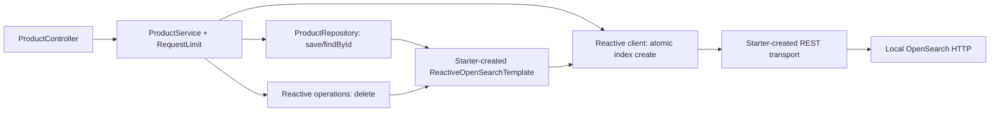

# Chapter 05: Document CRUD

เรียน **Create, Read, Update และ Delete** ของ product document ผ่าน `spring-data-opensearch-starter` แนวทางเดียวตามแผนที่อนุมัติ ใช้ reactive repository สำหรับ save/find, operations สำหรับ delete และ reactive-client tier สำหรับ atomic create-only ทุกอย่างเป็น standalone project ใช้ local HTTP ไม่มี authentication/TLS

## สารบัญ

- [เป้าหมายและ concepts](#concepts)
- [Prerequisites และ versions](#prerequisites)
- [เลือกเส้นทางเรียน](#learning-path)
- [Step 1–4: เตรียมและเปิดระบบ](#setup)
- [Step 5–9: ทดลอง CRUD](#crud)
- [Step 10: Refresh visibility](#refresh)
- [Step 11–12: Delete, smoke และ cleanup](#cleanup)
- [API contract และ validation](#api)
- [Troubleshooting](#troubleshooting)
- [Architecture และ configuration](#architecture)
- [Source guide และโครงสร้างไฟล์](#source)
- [Testing และหลักฐาน](#testing)
- [Sources](#sources)

<a id="concepts"></a>

## เป้าหมายและ concepts

| สิ่งที่จะเรียน | สิ่งที่ต้องสังเกต |
|---|---|
| Create-only | POST ID ใหม่ได้ 201 แต่ ID ซ้ำได้ 409 โดยข้อมูลเดิมไม่เปลี่ยน |
| Read | GET by ID เป็น realtime read แปลง document กลับเป็น DTO ผ่าน converter |
| Full replacement | PUT body ครบชุดแทน document เดิม fields ที่ไม่ได้อยู่ใน document ใหม่ไม่คงไว้ |
| Upsert | PUT ID ที่ไม่มีจะสร้างใหม่ ตอบ 200 ตาม contract ของบททั้งสองกรณี |
| Delete | ลบได้ 204; GET/DELETE หลังลบได้ 404 |
| Refresh visibility | GET กับ search อาจเห็นคนละสถานะจนกว่าจะ refresh |

ความรู้ prerequisite คือ HTTP/JSON, Reactor Mono และ mapping/settings แบบบท 04 แต่ไม่ต้องเปิด/build/seed บทอื่น

Update ในบทนี้คือ **full replacement** ไม่ใช่ partial update ไม่มี PATCH, scripted update, optimistic concurrency, bulk หรือ pagination ส่วน partial update/OCC อยู่บท 14 การ PUT ซ้ำให้ business state เหมือนเดิมได้ แต่ server อาจเพิ่ม internal version จึงไม่แปลว่าไม่มี write เกิดขึ้น

<a id="prerequisites"></a>

## Prerequisites และ versions

ต้องมี JDK 21, Docker Engine/Compose, Bash, cURL และ jq พร้อม ports `8085` และ `9205` ว่าง ใช้ Maven Wrapper ของบท ไม่ต้องติดตั้ง Maven แยก Docker VM/Linux ต้องมี memory/kernel limits ตาม [OpenSearch Docker prerequisites](https://docs.opensearch.org/latest/install-and-configure/install-opensearch/docker/)

| Component | Pin / policy |
|---|---|
| Java / Spring Boot | 21 / 4.1.2 |
| Spring Data OpenSearch starter | 3.1.4 |
| OpenSearch Java Client dependency / server | 3.10.0 / `opensearchproject/opensearch:3.9.0` |
| Maven / Wrapper | 3.9.11 / 3.3.4 |
| Tests | Boot-managed JUnit 6; resolved versions และ runtime evidence ใน [VERIFICATION](VERIFICATION.md) |

SDK dependency ให้ request/response types ที่ Spring Data reactive client ใช้ ไม่มี official-client application service หรือ `/api/java-client` route

<a id="learning-path"></a>

## เลือกเส้นทางเรียน

| เริ่มแบบไหน | ทำตามนี้ |
|---|---|
| ครั้งแรก | Step 1–12 ตามลำดับ |
| กลับมาเรียนต่อและมี JAR แล้ว | Step 2, 4 และตรวจ index ใน Step 5; ถ้ามี p-001 อยู่แล้ว POST ใน Step 6 จะ conflict ให้ GET ตรวจแล้วเลือกทำ PUT ต่อ |
| แก้ source หรือยังไม่มี JAR | รัน Step 3 ก่อนเปิด app |
| Smoke อย่างเดียว | เปิดระบบ Step 1–4 แล้วไป Step 12 โดย target index ต้องยังไม่มี |

Step 1–4 ใช้ **Terminal A** แล้วเปิด **Terminal B** สำหรับ API เพราะ app รัน foreground ค้างอยู่ ทุกคำสั่งใช้ defaults ของบท หากเปลี่ยน ports/index ให้เปลี่ยน URLs และ env ให้ตรงกัน ผลที่ควรเห็นเป็น expected behavior ไม่ใช่ output logs; ผลที่รันจริงอยู่ใน VERIFICATION

<a id="setup"></a>

### Step 1 — เข้า directory และเตรียม Compose configuration (Terminal A)

เริ่มจาก root repository:

```bash
cd 05-document-crud
if [ ! -f .env ]; then cp .env.example .env; fi
docker compose config --quiet
```

**ผลที่ควรเห็น:** คำสั่งจบโดยไม่มี error `.env` มีเพียง Compose host port ไม่ต้องสร้าง credentials หรือ certificates

### Step 2 — เปิด OpenSearch และตรวจ readiness (Terminal A)

```bash
docker compose up -d --wait opensearch
docker compose ps
curl -fsS 'http://localhost:9205/_cluster/health?wait_for_status=yellow&timeout=3s' | jq '{status, timed_out, number_of_nodes}'
```

**ผลที่ควรเห็น:** container healthy, nodes `1`, `timed_out=false`, health green หรือ yellow ได้ Compose ปิด security และ bind localhost สำหรับเครื่องเรียน ห้าม expose configuration นี้สู่อินเทอร์เน็ต มี persistent volume และปิด automatic business-index creation (`+.*,-*`) ไม่สร้าง index หรือ seed ข้อมูลตอน startup

### Step 3 — รัน tests และ build JAR (Terminal A)

```bash
./mvnw -B -ntp clean verify -Dmaven.compiler.showDeprecation=true
```

**ผลที่ควรเห็น:** `BUILD SUCCESS` และ `target/document-crud.jar` Maven เปิด Testcontainers อีก instance แยกจาก Compose เพื่อรัน ITs จึงต้องให้ Docker พร้อม ไม่ skip IT เมื่อ Docker หาย Compiler warnings ของ deprecated REST defaults เป็นข้อจำกัดที่เปิดเผยของ exact starter release

### Step 4 — เปิด application (Terminal A)

```bash
java -jar target/document-crud.jar
```

**ผลที่ควรเห็น:** app เริ่มที่ `127.0.0.1:8085` ปล่อย terminal นี้ค้างไว้ ยังไม่มี product index ถูกสร้าง

หากเปลี่ยน Compose port เป็น `19205` ให้ส่ง `OPENSEARCH_URI=http://localhost:19205` หน้า java command เอง Spring Boot ไม่โหลด Compose `.env` เข้า host JVM หาก app port ถูกใช้ให้ใช้ `APP_PORT=18085` และปรับ URLs ต่อไปให้ตรงกัน

<a id="crud"></a>

### Step 5 — ตรวจ precondition แล้วสร้าง index อย่างชัดเจน (Terminal B)

เปิดอีก terminal จาก root repository:

```bash
cd 05-document-crud
curl -sS -w '\nHTTP %{http_code}\n' http://localhost:8085/api/spring-data/products/p-001
```

**ผลเมื่อยังไม่มี index:** HTTP `503`, `code=INDEX_NOT_READY` app ตอบได้ แต่ต้อง setup ก่อน หากได้ 404 PRODUCT_NOT_FOUND แปลว่ามี index แล้วแต่ยังไม่มี ID; ถ้าได้ 200 แปลว่ามี product เดิมอยู่

```bash
bash scripts/initialize-indices.sh
```

**ผลที่ควรเห็น:** `Created ch05-products; no documents seeded` ถ้ามี index เดิม script แจ้งและไม่แก้หรือลบข้อมูล ให้ตรวจ mapping/settings ก่อน reuse:

```bash
curl -fsS http://localhost:9205/ch05-products/_mapping | jq
curl -fsS http://localhost:9205/ch05-products/_settings | jq
```

Mapping เป็น strict, stock integer, priceSatang long, createdAt date, name text + name.raw keyword และ `_class` keyword ที่ไม่ index/doc_values Settings เริ่ม shards=1, replicas=0, refresh=1s, coerce=false IT ตรวจ mapping resource เทียบกับ metadata ที่ annotations สร้างจริง

### Step 6 — Create-only (Terminal B)

```bash
curl -sS -i -X POST http://localhost:8085/api/spring-data/products/p-001 \
  -H 'Content-Type: application/json' --data-binary @fixtures/product.json
```

**ผลที่ควรเห็น:** HTTP `201`, `Location: /api/spring-data/products/p-001` และ product ที่มี id `p-001`, name `Mechanical Keyboard`, priceSatang `129900`, stock `10`, createdAt `2026-01-01T00:00:00Z` ราคาเป็นหน่วยสตางค์ (1,299.00 บาท) เพื่อหลีกเลี่ยง floating point

**สิ่งที่ได้เรียนรู้:** server ใช้ `op_type=create` ตัดสินแบบ atomic การเช็ก exists ก่อน save ไม่สามารถป้องกัน concurrent duplicate ได้

### Step 7 — สร้าง ID ซ้ำให้เกิด conflict (Terminal B)

```bash
curl -sS -w '\nHTTP %{http_code}\n' -X POST http://localhost:8085/api/spring-data/products/p-001 \
  -H 'Content-Type: application/json' --data-binary @fixtures/product-replacement.json
```

**ผลที่ควรเห็น:** HTTP `409` ตัวอย่าง error เฉพาะ fields สำคัญ (ไม่ใช่ response เต็ม):

```json
{
  "status": 409,
  "title": "Chapter 05 operation failed",
  "code": "PRODUCT_ALREADY_EXISTS"
}
```

### Step 8 — อ่านค่ากลับด้วย ID (Terminal B)

```bash
curl -fsS http://localhost:8085/api/spring-data/products/p-001 | jq
```

**ผลที่ควรเห็น:** ชื่อยังเป็น `Mechanical Keyboard` และ stock ยังเป็น `10` POST ที่ conflict ไม่ได้เขียนทับข้อมูลเดิม

**สิ่งที่ได้เรียนรู้:** repository.findById อ่านค่าปัจจุบันได้โดยไม่ต้องรอ search refresh และเติม ID จาก document metadata แม้ `_source` ไม่เก็บ id ซ้ำ

### Step 9 — Full replacement และ upsert ผ่าน PUT (Terminal B)

```bash
curl -fsS -X PUT http://localhost:8085/api/spring-data/products/p-001 \
  -H 'Content-Type: application/json' --data-binary @fixtures/product-replacement.json | jq
curl -fsS http://localhost:8085/api/spring-data/products/p-001 | jq
```

**ผลที่ควรเห็น:** ทั้งสองคำสั่ง HTTP `200` โดย name=`Wireless Keyboard`, category=`accessories`, priceSatang=`99000`, stock=`5`, available=`false` และ createdAt=`2026-01-02T00:00:00Z`

PUT ต้องส่ง body ครบ ลองส่งเพียง field เดียว:

```bash
curl -sS -w '\nHTTP %{http_code}\n' -X PUT http://localhost:8085/api/spring-data/products/p-001 \
  -H 'Content-Type: application/json' -d '{"stock":3}'
```

**ผลที่ควรเห็น:** `400 INVALID_REQUEST` partial update ไม่อยู่ใน endpoint นี้

ทดลอง ID ใหม่ที่ไม่มีอยู่ แล้วลบ sample เพิ่มเติม:

```bash
curl -fsS -X PUT http://localhost:8085/api/spring-data/products/p-new \
  -H 'Content-Type: application/json' --data-binary @fixtures/product.json | jq
curl -sS -w '\nHTTP %{http_code}\n' -X DELETE http://localhost:8085/api/spring-data/products/p-new
```

**ผลที่ควรเห็น:** PUT `200` สร้าง p-new ได้ และ DELETE `204` Full replacement ใช้ repository.save ซึ่งเป็น upsert ไม่ใช่ create-only

<a id="refresh"></a>

### Step 10 — พิสูจน์ GET กับ search visibility (Terminal B)

เพื่อไม่ให้การทดลองขึ้นกับความเร็วเครื่อง ให้ปิด periodic refresh ชั่วคราว แล้ว refresh baseline ก่อนเริ่ม ใช้ ID `p-visible` ที่ยังไม่มี ถ้ามีข้อมูลเดิมให้เลือก ID ใหม่และเปลี่ยนทั้ง URLs กับ query:

```bash
curl -fsS -X PUT http://localhost:9205/ch05-products/_settings \
  -H 'Content-Type: application/json' -d '{"index.refresh_interval":"-1"}' | jq
curl -fsS -X POST http://localhost:9205/ch05-products/_refresh | jq
curl -fsS -X POST http://localhost:8085/api/spring-data/products/p-visible \
  -H 'Content-Type: application/json' --data-binary @fixtures/product.json | jq
curl -fsS http://localhost:8085/api/spring-data/products/p-visible | jq
curl -fsS -X POST http://localhost:9205/ch05-products/_search \
  -H 'Content-Type: application/json' -d '{"query":{"ids":{"values":["p-visible"]}},"size":1}' | jq '.hits'
```

**ผลที่ควรเห็น:** GET พบ p-visible แต่ search มี hits ว่าง และ total.value=`0`, relation=`eq`

```bash
curl -fsS -X POST http://localhost:9205/ch05-products/_refresh | jq
curl -fsS -X POST http://localhost:9205/ch05-products/_search \
  -H 'Content-Type: application/json' -d '{"query":{"ids":{"values":["p-visible"]}},"size":1}' | jq '.hits'
```

**ผลที่ควรเห็น:** search พบ `_id=p-visible`, total.value=`1`, relation=`eq`

ลบแล้วลองอ่าน/search ก่อน refresh อีกครั้ง:

```bash
curl -sS -w '\nHTTP %{http_code}\n' -X DELETE http://localhost:8085/api/spring-data/products/p-visible
curl -sS -w '\nHTTP %{http_code}\n' http://localhost:8085/api/spring-data/products/p-visible
curl -fsS -X POST http://localhost:9205/ch05-products/_search \
  -H 'Content-Type: application/json' -d '{"query":{"ids":{"values":["p-visible"]}},"size":1}' | jq '.hits'
```

**ผลที่ควรเห็น:** DELETE `204`, GET `404` แต่ search ยังพบข้อมูลเดิมจนกว่าจะ refresh

```bash
curl -fsS -X POST http://localhost:9205/ch05-products/_refresh | jq
curl -fsS -X POST http://localhost:9205/ch05-products/_search \
  -H 'Content-Type: application/json' -d '{"query":{"ids":{"values":["p-visible"]}},"size":1}' | jq '.hits'
curl -fsS -X PUT http://localhost:9205/ch05-products/_settings \
  -H 'Content-Type: application/json' -d '{"index.refresh_interval":"1s"}' | jq
```

**ผลที่ควรเห็น:** search กลับเป็น 0 และคืน refresh interval เป็น `1s` แล้ว

**สิ่งที่ได้เรียนรู้:** refresh เปลี่ยน search visibility; ไม่ใช่การ rollback หรือรับรอง durability และไม่จำเป็นต้อง force refresh ทุก write ใน production IT/smoke พิสูจน์ช่วงหลัง repository PUT เพิ่มด้วยว่า GET เห็นค่าใหม่แต่ search ยังเห็นค่าเก่าก่อน refresh

<a id="cleanup"></a>

### Step 11 — ลบ product แล้วตรวจ missing (Terminal B)

```bash
curl -sS -w '\nHTTP %{http_code}\n' -X DELETE http://localhost:8085/api/spring-data/products/p-001
curl -sS -w '\nHTTP %{http_code}\n' http://localhost:8085/api/spring-data/products/p-001
curl -sS -w '\nHTTP %{http_code}\n' -X DELETE http://localhost:8085/api/spring-data/products/p-001
```

**ผลที่ควรเห็น:** `204`, `404 PRODUCT_NOT_FOUND`, `404 PRODUCT_NOT_FOUND` ตามลำดับ การลบซ้ำไม่เปลี่ยน business state แต่ HTTP contract เลือกรายงานว่ารอบหลังไม่พบ document

### Step 12 — Smoke test และหยุดระบบ

Smoke ต้องเริ่มโดย index ยังไม่มีและ app/Compose เปิดอยู่ Script ตรวจ CRUD/validation/conflict และ visibility หลัง create/replace/delete พร้อม assertions ไม่ใช่ดูแค่ HTTP 200

หากต้องการเก็บ index เดิมไว้ ให้ข้าม smoke หากต้องการลบ index และข้อมูลทั้งหมดของบทนี้เพื่อเริ่ม smoke ใหม่ ให้รันอย่างชัดเจน:

```bash
curl -fsS -X DELETE http://localhost:9205/ch05-products | jq
bash scripts/smoke-test.sh
```

**ผลที่ควรเห็น:** DELETE acknowledged และ smoke จบ exit `0` โดยลบ index ที่ตัวเองสร้าง Script ปฏิเสธ target index ที่มีอยู่ก่อนและไม่หยุด app/container Smoke ใช้ `APP_URL`, `OPENSEARCH_URI`, `LEARNING_INDEX_NAME` ให้ตรงกับ app

หยุด app ด้วย **Ctrl+C ใน Terminal A** แล้วใน Terminal B รัน:

```bash
docker compose down
```

ไม่ใส่ `-v` จึงเก็บ volume ไว้ หากข้าม smoke และไม่ลบ index ข้อมูลจะยังอยู่เมื่อเปิดระบบใหม่

<a id="api"></a>

## API contract และ validation

| Method หลัง `/api/spring-data` | Success | Representative failure |
|---|---|---|
| POST `/products/{id}` | 201 product + Location | 409 PRODUCT_ALREADY_EXISTS |
| PUT `/products/{id}` | 200 product (create หรือ replace) | 400 INVALID_REQUEST |
| GET `/products/{id}` | 200 product | 404 PRODUCT_NOT_FOUND |
| DELETE `/products/{id}` | 204 ไม่มี body | 404 PRODUCT_NOT_FOUND |

ID รับ `[a-zA-Z0-9_-]{1,64}` ผิดรูปแบบได้ `400 INVALID_PRODUCT_ID` Body ต้องครบ name (ไม่ว่าง max 120), category (ไม่ว่าง max 64), priceSatang/stock (integer >=0), available และ createdAt (Instant) ไม่รับทศนิยมใน stock/priceSatang และไม่รับ unknown fields เช่น `id` ใน body วันที่ไม่มี timezone หรือ parse ไม่ได้เป็น 400

Index ไม่มี → `503 INDEX_NOT_READY`, backend ไม่พร้อม → `503 OPENSEARCH_UNAVAILABLE`, deadline → `504 OPENSEARCH_TIMEOUT`, backend rejected → `400 OPENSEARCH_REQUEST_REJECTED`, เกิน logical in-flight limit → `503 REQUEST_LIMIT_EXCEEDED` Error เป็น ProblemDetail มี code โดยไม่เปิดเผย transport details

<a id="troubleshooting"></a>

## Troubleshooting

| อาการ | ตรวจและแก้อย่างไร |
|---|---|
| Docker/Testcontainers ไม่พร้อม | `docker info` ต้องผ่านก่อนรัน tests ใหม่ ไม่ skip IT |
| OpenSearch ไม่ healthy | `docker compose logs --tail=100 opensearch` ตรวจ memory/kernel requirements |
| Port ถูกใช้ | `docker compose ps`; บนเครื่องที่มี lsof ใช้ `lsof -nP -iTCP:8085 -sTCP:LISTEN` เปลี่ยน APP_PORT หรือ OPENSEARCH_PORT และ URI ให้ตรง |
| cURL connection refused | ดู startup log ใน Terminal A และ app port |
| INDEX_NOT_READY | รัน setup script และตรวจ LEARNING_INDEX_NAME ของ app กับ script ให้ตรง |
| OPENSEARCH_UNAVAILABLE | เรียก health ใน Step 2 ตรวจ host URI; Compose .env ไม่เปลี่ยน host JVM env |
| PRODUCT_ALREADY_EXISTS | POST เป็น create-only ถ้าต้องการแทนที่ให้ตรวจ ID เดิมแล้วใช้ PUT |
| PUT ข้อมูลบาง field แล้วได้ 400 | ส่ง body ครบชุด ไม่มี PATCH ในบทนี้ |
| GET พบแต่ search ไม่พบ | ทำ Step 10; ตรวจ refresh interval และ field/query |
| Smoke ปฏิเสธ index เดิม | เก็บข้อมูลแล้วข้าม หรือเลือก DELETE เฉพาะ index ของบทก่อนรันใหม่ |

<a id="architecture"></a>

## Architecture และ configuration



| Feature | Actual API tier |
|---|---|
| POST create-only | ReactiveOpenSearchClient.index(OpType.Create) + starter-created converter.mapObject |
| PUT/GET | Native reactive repository save/findById |
| DELETE | Native operations.delete คืน empty เมื่อไม่พบ แปลงเป็น 404 |
| Refresh experiments/setup | Explicit native API ใน scripts/README/tests ไม่มี public admin endpoint |

Spring Data OpenSearch สร้างบน Spring Data Elasticsearch จึงมีชื่อ ReactiveElasticsearchRepository/Operations/ElasticsearchConverter แต่ runtime ใช้ OpenSearch implementations ตรวจ bean origins และ real-server behavior ใน IT ไม่มี official application path, two-path parity หรือ cross-chapter dependency

Starter 3.1.4 สร้าง client/transport/template/converter และ reactive repository เอง ไม่สร้าง infrastructure ทดแทน ไม่ exclude auto-configurations SDK เป็น explicit dependency เพราะ published starter/core POM ไม่ให้ SDK เอง Exclude high-level REST และ Elasticsearch REST client dependencies ที่ไม่ได้ใช้ Native starter อาจมี synchronous infrastructure beans อยู่บน classpath แต่ application ไม่เรียก sync client/repository ใน request flow

`BeanPostProcessor` ตั้ง `RefreshPolicy.NONE` บน starter-created reactive template ก่อน repository ใช้งาน Exact repository release จะ refresh เพิ่มเมื่อ template policy เป็น null จึงตั้งค่าและพิสูจน์ visibility จริงใน IT ไม่ใช้ repository.save แล้วอ้างว่าทุก release มี refresh semantics เหมือนกัน

RestClientBuilderCustomizer ปิด retries/redirects ตั้ง response timeout และจำกัด starter-created pool เป็น 16 connections ไม่สร้างหรือปิด client/transport เอง REST transport/builder default deprecated ใน exact release นี้ จงอ่าน compiler warnings มีการตรวจ context shutdown ตาม native lifecycle ไม่เพิ่ม close callbacks ซ้อนหรืออ้าง single-close ownership

| Property | Env | Default |
|---|---|---|
| server.address / port | APP_HOST / APP_PORT | 127.0.0.1 / 8085 |
| opensearch.uris | OPENSEARCH_URI | http://localhost:9205 |
| opensearch.connection-timeout | OPENSEARCH_CONNECT_TIMEOUT | 1s (connect/pool acquisition) |
| opensearch.socket-timeout | OPENSEARCH_RESPONSE_TIMEOUT | 3s (customizer apply response timeout) |
| learning.request-timeout | OPENSEARCH_REQUEST_TIMEOUT | 5s; 1..60s และ >= response timeout |
| learning.index-name | LEARNING_INDEX_NAME | ch05-products; namespace ch05- |

Transport timeouts รับ 1ms..60s URI ต้องเป็น HTTP host เดียว ไม่มี credentials/path/query/fragment ไม่มี configuration transport ซ้ำใน learning

ทุก operation defer ก่อน subscription และสร้างคำสั่งใหม่เมื่อ resubscribe/retry ไม่มี automatic write retry หรือ blocking ใน request flow Semaphore tryAcquire จำกัด logical in-flight operations ที่ 16 ไม่มี waiting queue และคืน permit เมื่อ complete/error/cancel ขณะที่ transport pool จำกัด physical connections แยกกัน Reactor timeout/cancel ไม่รับประกันหยุด HTTP I/O, server write หรือ rollback ดังนั้น write timeout ต้องตรวจสถานะก่อนลองใหม่

Fixtures เป็นข้อมูลสังเคราะห์สำหรับบทนี้ ไม่มี external dataset ใช้ IDs และ timestamps คงที่ `_id` เป็น metadata ไม่อยู่ใน `_source`; `_class` เป็น converter type hint ไม่มี field สำหรับ seq_no/primary_term ใน public DTO

<a id="source"></a>

## Source guide และโครงสร้างไฟล์

เริ่มอ่าน [ProductController](src/main/java/com/example/learning/opensearch/documentcrud/controller/ProductController.java) → [ProductService](src/main/java/com/example/learning/opensearch/documentcrud/service/ProductService.java) → [ProductRepository](src/main/java/com/example/learning/opensearch/documentcrud/repository/ProductRepository.java) และ [ProductDocument](src/main/java/com/example/learning/opensearch/documentcrud/domain/ProductDocument.java) แล้วดู [configuration](src/main/java/com/example/learning/opensearch/documentcrud/config/OpenSearchConfiguration.java), [RequestLimit](src/main/java/com/example/learning/opensearch/documentcrud/service/RequestLimit.java) และ [real-server IT](src/test/java/com/example/learning/opensearch/documentcrud/integration/DocumentCrudIT.java)

```text
05-document-crud/
├── .mvn/
│   └── wrapper/
│       └── maven-wrapper.properties
├── fixtures/
│   ├── product-replacement.json
│   └── product.json
├── requests/
│   └── examples.http
├── scripts/
│   ├── initialize-indices.sh
│   └── smoke-test.sh
├── src/
│   ├── main/
│   │   ├── java/
│   │   │   └── com/
│   │   │       └── example/
│   │   │           └── learning/
│   │   │               └── opensearch/
│   │   │                   └── documentcrud/
│   │   │                       ├── config/
│   │   │                       │   ├── LearningProperties.java
│   │   │                       │   └── OpenSearchConfiguration.java
│   │   │                       ├── controller/
│   │   │                       │   └── ProductController.java
│   │   │                       ├── domain/
│   │   │                       │   └── ProductDocument.java
│   │   │                       ├── dto/
│   │   │                       │   ├── ProductRequest.java
│   │   │                       │   └── ProductResponse.java
│   │   │                       ├── exception/
│   │   │                       │   ├── ApiExceptionHandler.java
│   │   │                       │   └── ChapterException.java
│   │   │                       ├── repository/
│   │   │                       │   └── ProductRepository.java
│   │   │                       ├── service/
│   │   │                       │   ├── ProductService.java
│   │   │                       │   └── RequestLimit.java
│   │   │                       └── DocumentCrudApplication.java
│   │   └── resources/
│   │       ├── opensearch/
│   │       │   └── product-index.json
│   │       └── application.yml
│   └── test/
│       └── java/
│           └── com/
│               └── example/
│                   └── learning/
│                       └── opensearch/
│                           └── documentcrud/
│                               ├── config/
│                               │   └── ConfigurationTest.java
│                               ├── controller/
│                               │   └── ProductControllerTest.java
│                               ├── exception/
│                               │   └── ApiExceptionHandlerTest.java
│                               ├── integration/
│                               │   └── DocumentCrudIT.java
│                               └── service/
│                                   ├── ProductServiceTest.java
│                                   └── RequestLimitTest.java
├── .env.example
├── .gitignore
├── README.md
├── VERIFICATION.md
├── docker-compose.yml
├── mvnw
├── mvnw.cmd
└── pom.xml
```

<a id="testing"></a>

## Testing และหลักฐาน

Maven Step 3 รัน unit/HTTP/configuration และ real OpenSearch ITs ผ่าน Surefire/Failsafe Tests ตรวจ lazy/fresh invocation, sync/async failures, cancellation/deadline, limit/release, validation/errors, starter bean origins, dynamic repository index coordinates, generated mapping/converter, create conflict, replacement (รวมการเอา old field ออก), missing/delete และ refresh visibility หลัง create/replace/delete พร้อม native shutdown

IT ใช้ random ports และ unique ch05-it-* index ลบเฉพาะ resources ที่สร้าง ขณะที่ smoke ใช้ Compose + packaged JAR บน host แยกจาก tests รายงานผลและ tested platform อยู่ [VERIFICATION.md](VERIFICATION.md) ไม่ถือ mock หรืออ่าน source เป็น runtime verification

**แบบฝึกหัด:** ลอง PUT ID เดิมซ้ำแล้วอ่าน internal version ผ่าน native GET; ลอง timestamp ที่มี offset แล้วตรวจ Instant; อธิบายว่าทำไม DELETE ซ้ำได้ 404 แต่ผลสุดท้ายยังไม่มี document Partial update/OCC ให้เรียนต่อในบทที่กำหนดตาม roadmap

<a id="sources"></a>

## Sources

- [Spring Data OpenSearch v3.1.4](https://github.com/opensearch-project/spring-data-opensearch/tree/v3.1.4)
- [OpenSearch Index Document API](https://docs.opensearch.org/latest/api-reference/document-apis/index-document/)
- [Get Document API](https://docs.opensearch.org/latest/api-reference/document-apis/get-documents/)
- [Delete Document API](https://docs.opensearch.org/latest/api-reference/document-apis/delete-document/)
- [Refresh API](https://docs.opensearch.org/latest/api-reference/index-apis/refresh/)

Latest links อาจเปลี่ยน Runtime evidence จำกัด pinned versions และ platform ในรายงาน ตรวจ exact source JAR ของ starter/core 3.1.4 และ Spring Data Elasticsearch 6.1.2 ประกอบแล้ว
