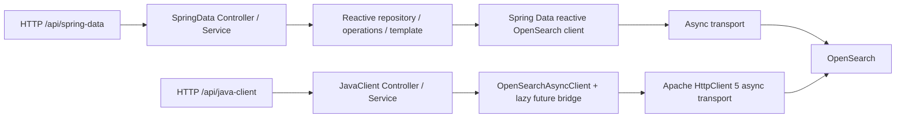

# Architecture

แต่ละ `NN-topic-name/` เป็น standalone Java 21/Spring Boot project มี parent โดยตรง (`relativePath` ว่าง), Wrapper/Compose/fixtures/tests ของตัวเอง ไม่มี cross-chapter dependency หรือ root reactor

## สอง application paths

ทั้งสอง path ใช้ shared DTO semantics และ equivalent fixtures แยก vendor integration และ error translation ให้ตรวจได้ ไม่สร้าง universal adapter ซ่อนความแตกต่าง เปรียบเทียบ Spring Data abstraction กับ explicit client ตาม [dual-approach contract](dual-approach.md)

Connection/health APIs ใช้ reactive client ของ Spring Data ได้เมื่อไม่มี repository-level operation ที่เหมาะสม บท document ใช้ repository/operations/template เพื่อสอน object mapping จริง ไม่เอา direct async service เดิมมาตั้งชื่อ SpringData แล้วนับเป็นอีกแนวทาง

Spring Data OpenSearch สร้างบน Spring Data Elasticsearch จึงมี API names จาก upstream แต่ต้อง wire OpenSearch implementation หลีกเลี่ยง accidental Elasticsearch auto-configuration/readiness checks Transport singleton มี close owner ชัดเจน จะใช้ร่วมกันหรือแยกต้องตรวจ mapper/security/options และ qualifiers ก่อน

Default transport ของ Spring Data candidate ต้องตรวจจาก source ไม่สมมติว่าเป็น Apache HttpClient 5 เหมือน direct path ส่วน server ใช้ JVM ใน image แยกจาก JDK application

Single-node Compose ใช้เรียน ไม่พิสูจน์ HA/performance Tests ใช้ random ports แยกจาก Compose Write parity tests reset หรือแยก equivalent resources ระหว่างสอง path

## Chapter 01

Chapter 01 implement สอง path แล้ว: `/api/spring-data/cluster/*` ใช้ ReactiveOpenSearchClient และ `/api/java-client/cluster/*` ใช้ OpenSearchAsyncClient ทั้งสอง share Apache HttpClient 5 transport ที่ Spring ปิดจุดเดียว เก็บ `/api/cluster/*` เป็น official aliases พร้อม tests และ smoke จริง ดู [current verification](../01-basic-connection/VERIFICATION.md)

## เหตุผลของโครงสร้าง

Standalone projects ทำให้เลือกเรียนแต่ละบทและรัน tests ได้ทันทีโดยไม่ build หรือ seed บทอื่น ยอมรับการซ้ำของ POM/configuration เพื่อให้บทอ่านและรันได้ด้วยตัวเอง ไม่สร้าง shared runtime module หรือ root Maven reactor

แต่ละบทใช้ชื่อ `NN-topic-name` ตาม [roadmap](learning-roadmap.md) มี POM/Wrapper/Compose/tests ของตัวเองและสอง approach ใน project เดียว ไม่สร้าง empty future directories โครงสร้างและเอกสารประจำบทใช้ [chapter template](chapter-template.md) เพิ่ม packages/resources เฉพาะที่บทใช้งานจริง

Chapter 03 มี approved exception: ใช้ spring-data-opensearch-starter แนวทางเดียว เป็น standalone Maven project ที่ directory ของบท พร้อม Compose/scripts/tests ของตัวเอง ใช้ starter auto-configuration สร้าง client/transport/data infrastructure และ RestClientBuilderCustomizer เพิ่ม API Key โดยไม่ exclude auto-configurations ใช้ JVM default trust ไม่มี core-only project หรือ shared runtime module ดู [contract exception](dual-approach.md#chapter-03-approved-starter-only-scope)
